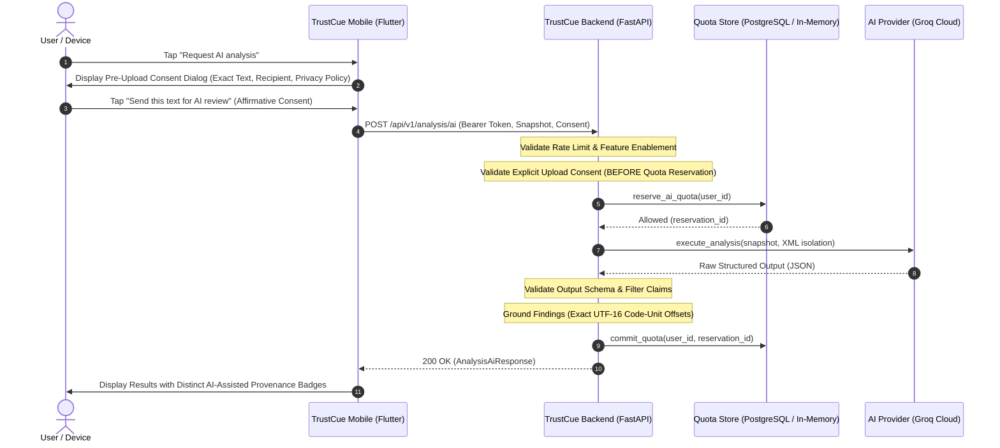

# Module 35: Mobile Upload Consent and Optional AI Workflow

## Overview
Module 35 completes the activation of the protected server-assisted AI scam-indicator analysis pipeline by introducing explicit, per-request client upload consent and un-gating the `POST /api/v1/analysis/ai` endpoint.

Prior to Module 35, the endpoint returned HTTP 503 pending mobile upload consent implementation. With this module, the endpoint is fully operational when:
1. An authenticated client submits a valid text snapshot.
2. The request contains explicit, affirmative per-request upload consent (`granted: true`).
3. The consent metadata references a supported disclosure version (`1.0.0`), recipient (`trustcue-backend`), and provider (`groq-cloud` or `google-gemini`).
4. The user has remaining daily request quota (default: 15 requests/day).

---

## Architecture & Data Flow



---

## 1. Explicit Per-Request Upload Consent Contract

### Protocol Schema (`UploadConsentMetadata`)
```json
{
  "granted": true,
  "disclosureVersion": "1.0.0",
  "timestamp": "2026-10-15T12:00:00Z",
  "recipient": "trustcue-backend",
  "provider": "groq-cloud"
}
```

### Pre-Quota Validation Invariant
Consent is evaluated **strictly prior** to quota reservation, database locks, or external network requests. If consent is absent, `granted: false`, or references an unsupported disclosure version or recipient, the request fails immediately with HTTP 400 Bad Request:
- Missing consent or `granted: false` ➔ `code: "consent_required"`
- Unsupported version ➔ `code: "unsupported_disclosure_version"`
- Unauthorized recipient ➔ `code: "invalid_consent_recipient"`
- Unsupported provider ➔ `code: "unsupported_ai_provider"`

---

## 2. Supported AI Providers and Models

### Groq Cloud API
- **Endpoint:** `https://api.groq.com/openai/v1/chat/completions`
- **Supported Models:**
  - `qwen/qwen3.8-27b`: Fast, deterministic JSON generation, tested live with 100% exact evidence grounding.
  - `llama-3.3-70b-versatile`: Production enterprise default on tiers where enabled.
- **Privacy & Retention Policy:**
  - Prompts are processed ephemerally on specialized Language Processing Units (LPUs).
  - All communication is encrypted in transit via TLS.
  - User data is never used to train or refine foundational AI models.

---

## 3. Provenance and Safe Display Boundaries
- **Provenance Separation:** The mobile client displays local rule findings with `[On-device heuristic]` badges and cloud AI findings with `[Cloud AI: Groq]` badges.
- **Inert Text Rendering:** Model-generated explanations are rendered as inert text without executing scripts, rendering HTML, or making links clickable automatically.
- **Absence of Indicators:** If zero scam indicators are matched, the UI explicitly explains that the absence of indicators does NOT establish safety, verify authenticity, or guarantee legitimacy.

