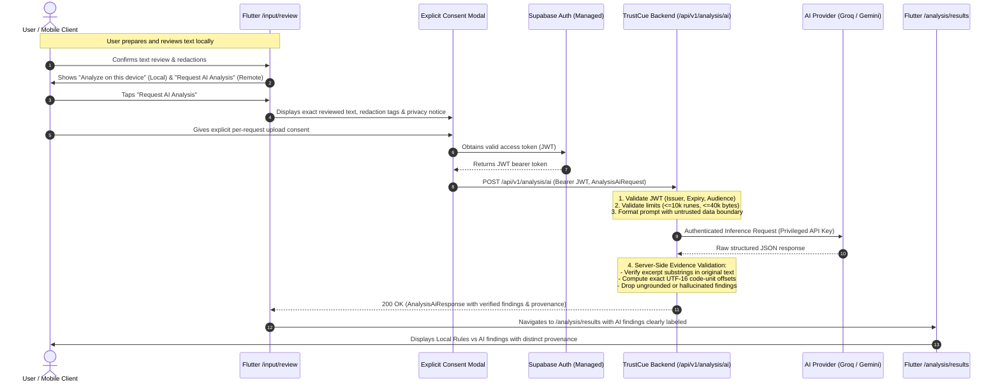

# TrustCue Backend Architecture & Service Feasibility

## 1. Executive Summary & Purpose

TrustCue is a privacy-first mobile application designed to explain potential scam warning indicators in digital communication.
While core analysis operates 100% on-device using deterministic heuristic rules (completed in Modules 22–26), Module 27 establishes the architecture, service feasibility, privacy decisions, and API contracts for **server-assisted, protected AI analysis**, managed authentication, and optional encrypted cloud backup.

### Core Architectural Mandates:
1. **Local-First Independence:** Local analysis on the mobile device must remain 100% available without network access, user registration, or server dependencies.
2. **Zero Financial Expenditure:** Built entirely within verifiable, non-expiring free tiers without requiring paid billing or mandatory payment cards for development.
3. **Pakistan Developer Feasibility:** Fully operable, accessible, and testable from Pakistan (Rawalpindi/Islamabad timezone, UTC+5) without regional geo-blocking or payment-card lockouts.
4. **Zero Client Secret Leakage:** Privileged AI provider keys, database connection strings, and service role credentials reside exclusively on the secure backend.
5. **Rigorous Evidence Grounding:** AI findings must be grounded in exact UTF-16 code-unit excerpts of the submitted text, verified server-side before delivery to mobile clients.

---

## 2. Research & Stack Feasibility Analysis

A thorough evaluation of cloud hosting, managed authentication, database persistence, and AI inference providers was conducted as of **October 2026** against academic project constraints (CS3643, BSCS Semester 5-1, Fall 2026, Riphah International University).

### 2.1 Technology Evaluation Matrix

| Category | Candidate A (Recommended) | Candidate B (Fallback) | Candidate C (Rejected) |
|---|---|---|---|
| **Backend Runtime** | **Node.js (TypeScript) + Fastify** | **Python 3.11+ + FastAPI** | **Dart (Dart Frog / Shelf)** |
| **Official Docs** | [fastify.dev](https://fastify.dev) | [fastapi.tiangolo.com](https://fastapi.tiangolo.com) | [dartfrog.vgv.dev](https://dartfrog.vgv.dev) |
| **Hosting** | **Render (Free Web Service)** | **Hugging Face Spaces (Docker)** | **Railway / Fly.io** |
| **Official Docs** | [render.com/docs/free](https://render.com/docs/free) | [huggingface.co/docs/spaces](https://huggingface.co/docs/spaces) | [railway.app/pricing](https://railway.app/pricing) |
| **Managed Auth & DB** | **Supabase (Auth + PostgreSQL)** | **Firebase (Auth + Cloud Firestore)** | **Neon + Auth0** |
| **Official Docs** | [supabase.com/docs](https://supabase.com/docs) | [firebase.google.com/docs](https://firebase.google.com/docs) | [neon.tech/docs](https://neon.tech/docs) |
| **AI Inference** | **Groq Cloud API / Google Gemini** | **Cloudflare Workers AI** | **OpenAI API** |
| **Official Docs** | [groq.com/docs](https://console.groq.com/docs) | [developers.cloudflare.com/workers-ai](https://developers.cloudflare.com/workers-ai) | [platform.openai.com/docs](https://platform.openai.com/docs) |
| **Transactional Email** | **Supabase Auth + Resend Free** | **Brevo (formerly Sendinblue)** | **Custom Postfix / AWS SES** |
| **Official Docs** | [resend.com/docs](https://resend.com/docs) | [brevo.com](https://www.brevo.com) | [aws.amazon.com/ses](https://aws.amazon.com/ses) |

---

### 2.2 Deep-Dive Feasibility by Component

#### A. Backend Language & Runtime
- **Primary Selection: Node.js (TypeScript) + Fastify**
  - *Rationale:* Lightweight, high-throughput HTTP framework with schema-driven validation (TypeBox/JSON Schema), low memory footprint (<80 MB at idle), and native TypeScript support. The official `@supabase/supabase-js` and AI client SDKs are first-party and mature.
  - *Cold Start:* Sub-second process initialization, minimizing the cold-start penalty on free container hosting.
- **Fallback: Python 3.11+ + FastAPI**
  - *Rationale:* Native Pydantic v2 validation, automatic OpenAPI generation. Slightly higher base memory footprint (~120–150 MB).

#### B. Hosting Platform
- **Primary Selection: Render Free Web Service**
  - *Official Source:* [render.com/docs/free](https://render.com/docs/free) (Verified October 2026).
  - *Free Tier Limits:* 512 MB RAM, 0.1 vCPU, 750 free instance hours per month, 100 GB monthly bandwidth.
  - *Credit Card Requirement:* **None.** No payment card required for free web services or static sites.
  - *Inactivity Behavior:* Spins down container after **15 minutes of inactivity**. Cold start takes approximately 50 seconds upon receiving a new incoming request.
  - *Pakistan Availability:* Fully accessible without geographic blocks.
  - *Local Development:* Local development executes on `http://localhost:3000`, completely bypassing cold starts during coding and testing.
- **Why Alternatives Were Rejected:**
  - *Railway:* Eliminated free tier; requires credit card and min. $5/month billing.
  - *Fly.io:* Requires international credit card upfront for account verification even on the free allowance.
  - *Render Free PostgreSQL:* Automatically deleted after 30 days; unusable for persistent project database.

#### C. Managed Authentication & Database
- **Primary Selection: Supabase (Auth + PostgreSQL)**
  - *Official Source:* [supabase.com/pricing](https://supabase.com/pricing) (Verified October 2026).
  - *Free Tier Limits:* 500 MB Postgres database storage, 50,000 Monthly Active Users (MAUs), Row Level Security (RLS), 500 MB RAM shared compute.
  - *Credit Card Requirement:* **None.** Free tier projects do not require payment details.
  - *Inactivity Policy:* Free projects are paused after **7 days of inactivity** (no database queries or auth requests). Can be manually unpaused in 1-click via web dashboard with zero data loss.
  - *Authentication:* Built-in JWT issuing (RS256/HS256), email/password signup, email verification, password reset, and secure token refreshes.
  - *Pakistan Availability:* Fully accessible without restrictions.
- **Email Delivery Constraints & Resolution:**
  - *Supabase Default Mailer:* Strictly rate-limited to **2 to 4 emails per hour** for development. If exceeded, returns HTTP `429 over_email_send_rate_limit`.
  - *Production/Testing Resolution:* Free custom SMTP via **Resend** ([resend.com](https://resend.com), 100 emails/day, 3,000 emails/month free without credit card for development testing) or Gmail SMTP app password.

#### D. AI Inference Provider & Privacy Feasibility
- **Crucial Privacy Finding (October 2026 Terms of Service):**
  - **Google AI Studio / Gemini API Free Tier:** Under Google's unpaid terms, **Google uses submitted prompts and generated responses for machine learning training**, and data may be inspected by human reviewers outside the EEA/UK/Switzerland ([ai.google.dev/terms](https://ai.google.dev/terms)).
  - **Groq Cloud API Free Tier:** Under Groq's terms, **Groq DOES NOT train on customer inference data by default**, and standard inference requests have **zero default data retention** ([groq.com/privacy-policy](https://groq.com/privacy-policy)).
- **Dual AI Strategy:**
  1. **Groq Cloud API (Primary Privacy-Preserving Inference):**
     - Models: `llama-3.3-70b-versatile`, `llama-3.1-8b-instant`.
     - Free Tier Quota: 30 Requests Per Minute (RPM), 14,400 Requests Per Day (RPD).
     - Privacy: Zero default retention; no training on user prompts.
     - Credit Card: **None.**
     - Pakistan Availability: Supported and globally reachable.
  2. **Google Gemini API (Secondary / Fallback with Synthetic Policy):**
     - Models: `gemini-1.5-flash`.
     - Free Tier Quota: 15 RPM, 1,500 RPD, 1 million TPM.
     - **Mandatory Policy:** Under zero financial expenditure (unpaid tier), Gemini API must be used **strictly with synthetic demo scenarios and anonymized test fixtures**. If real personal messages are evaluated, either Groq Cloud must be used or a Google Cloud Billing account must be attached (which activates Paid Service terms prohibiting model training).

---

## 3. Recommended vs Fallback Stack Summary

### Primary Recommended Stack
- **Backend Language:** TypeScript (Node.js 20+ LTS)
- **Framework:** Fastify 4.x / 5.x
- **Hosting:** Render Free Web Service (Production staging) + Local Node runtime (Development)
- **Authentication:** Supabase Auth (JWT bearer tokens, PKCE mobile flow)
- **Database:** Supabase Managed PostgreSQL (RLS, schema migrations, cascade deletion)
- **Primary AI Provider:** Groq Cloud API (`llama-3.3-70b-versatile` / `llama-3.1-8b-instant`) — Zero retention, no training
- **Secondary AI Provider:** Google Gemini API (`gemini-1.5-flash`) — Synthetic-only data policy on free tier
- **Email:** Supabase default testing mailer (dev) + Resend SMTP (testing/staging)

### Realistic Fallback Stack
- **Backend Language:** Python 3.11+
- **Framework:** FastAPI + Pydantic v2
- **Hosting:** Hugging Face Spaces (Docker runtime) / Local Docker
- **Authentication & Database:** Firebase Auth + Cloud Firestore (Blaze free allocation)
- **AI Provider:** Cloudflare Workers AI (Llama 3 on edge) or Groq Cloud

---

## 4. End-to-End System Architecture & Data Flow



---

## 5. Trust Boundaries & Security Rules

### 5.1 Privileged Secrets vs Public Client Configuration

| Secret / Config Parameter | Safe Location | Strictly Forbidden Location |
|---|---|---|
| AI Provider API Key (Groq / Gemini) | Backend Environment Variables (`.env`) | Flutter Client, Git repositories |
| Supabase Service Role Key | Backend Environment Variables (`.env`) | Flutter Client, Git repositories |
| Database Connection String (`DATABASE_URL`) | Backend Environment Variables (`.env`) | Flutter Client, Git repositories |
| Supabase Project URL | Flutter Client & Backend Config | Git public secrets |
| Supabase Anon Key (Public Key) | Flutter Client (`anon` public key) | Privileged administrative services |
| Backend Base URL | Flutter Client (`https://...` or `localhost`) | — |

### 5.2 Mobile Session Storage
- Mobile access tokens and refresh tokens will be stored exclusively in platform-secure hardware storage using `flutter_secure_storage` (Android Keystore / EncryptedSharedPreferences).
- Tokens are never written to unencrypted `SharedPreferences`, log files, or route arguments.

### 5.3 Authentication & Authorization Rules
1. **JWT Verification:** TrustCue Backend verifies JWT signatures using Supabase's JWKS endpoint or shared JWT secret. Claims validated:
   - `iss`: Matches Supabase project URL (`https://<project-ref>.supabase.co/auth/v1`).
   - `aud`: Matches `authenticated`.
   - `exp`: Current UTC time must be less than expiration timestamp.
   - `sub`: User UUID extracted and injected into request context.
2. **Account Ownership:** All user endpoints enforce `auth.uid() == resource.user_id`. Users can never query or modify another user's profile, quotas, or synched reports.
3. **CORS Clarification:** CORS headers are strictly browser controls. Because TrustCue is a native mobile app (making non-browser HTTP calls), CORS does not provide authentication or prevent abuse. API abuse prevention relies on JWT authentication and per-account IP/token rate limiting.

---

## 6. Server-Side Evidence Grounding Policy

Model-generated character offsets cannot be trusted blindly due to language-model tokenization quirks and hallucination risks.
The TrustCue backend enforces a **strict server-side evidence verification algorithm**:

```
For each finding returned by AI Model:
  1. Extract quoted 'excerpt' string.
  2. Search for exact occurrence of 'excerpt' in submitted 'text' snapshot.
  3. If excerpt is NOT found:
     - Attempt single normalized whitespace match.
     - If still not found, DISCARD finding as ungrounded hallucination.
  4. If excerpt is found:
     - Compute exact UTF-16 code-unit indices: startOffset and endOffset.
     - If excerpt appears multiple times, use disambiguation context from AI or pick the first matching occurrence.
     - Verify text.substring(startOffset, endOffset) === excerpt.
     - Ensure offsets do not bisect UTF-16 surrogate pairs.
  5. Findings that pass validation are assigned server IDs and added to response.
```

If all findings fail evidence grounding, the backend returns an outcome indicating zero verified indicators matched, preserving safety without fabricating evidence.

---

## 7. Local Development vs Staging Environments

- **Local Development (`NODE_ENV=development`):**
  - Server listens on `http://localhost:3000`.
  - Android device / emulator connects via `adb reverse tcp:3000 tcp:3000` or `10.0.2.2:3000`.
  - Fast feedback loop, zero cold starts, zero network latency.
- **Hosted Staging (`NODE_ENV=production`):**
  - Hosted on Render free web service.
  - HTTPS enforced automatically via Let's Encrypt certificates.
  - Sleep mode after 15 minutes of inactivity; client displays clear waiting/connecting indicator during cold starts.
