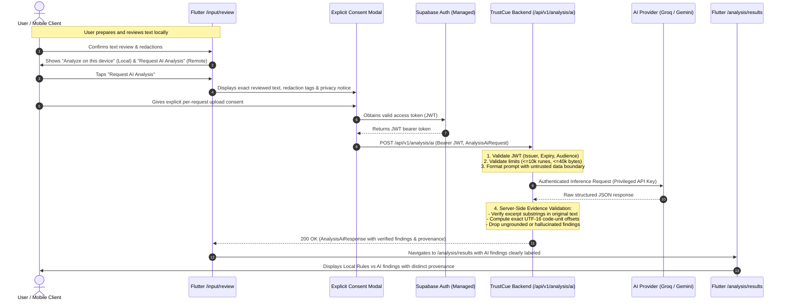

# TrustCue Backend Architecture & Service Feasibility

## 1. Executive Summary & Purpose

TrustCue is a privacy-first mobile application designed to explain potential scam warning indicators in digital communication.
While core analysis operates 100% on-device using deterministic heuristic rules (completed in Modules 22–26), Module 27 establishes the architecture, service feasibility, privacy decisions, and API contracts for **server-assisted, protected AI analysis**, managed authentication, and optional encrypted cloud backup.

### Core Architectural Mandates:
1. **Local-First Independence:** Local analysis on the mobile device must remain 100% available without network access, user registration, or server dependencies.
2. **Zero Financial Expenditure:** Built entirely within verifiable, non-expiring free tiers without requiring paid billing or mandatory payment cards for development.
3. **Pakistan Developer Feasibility:** Fully operable, accessible, and testable from Pakistan (Rawalpindi/Islamabad timezone, UTC+5) without regional geo-blocking or payment-card lockouts.
4. **Zero Client Secret Leakage:** Privileged AI provider keys, database connection strings, and service role credentials reside exclusively on the secure backend.
5. **Rigorous Evidence Grounding:** AI findings must be grounded in exact UTF-16 code-unit excerpts of the submitted text, verified server-side before delivery to mobile clients.

---

## 2. Research & Stack Feasibility Analysis

A thorough evaluation of cloud hosting, managed authentication, database persistence, and AI inference providers was conducted as of **October 2026** against academic project constraints (CS3643, BSCS Semester 5-1, Fall 2026, Riphah International University).

### 2.1 Technology Evaluation Matrix

| Category | Primary Selected | Candidate B (Alternative) | Candidate C (Rejected) |
|---|---|---|---|
| **Backend Runtime** | **Python 3.13+ + FastAPI** | **Node.js (TypeScript) + Fastify** | **Dart (Dart Frog / Shelf)** |
| **Official Docs** | [fastapi.tiangolo.com](https://fastapi.tiangolo.com) | [fastify.dev](https://fastify.dev) | [dartfrog.vgv.dev](https://dartfrog.vgv.dev) |
| **Hosting** | **Render (Free Web Service)** | **Hugging Face Spaces (Docker)** | **Railway / Fly.io** |
| **Official Docs** | [render.com/docs/free](https://render.com/docs/free) | [huggingface.co/docs/spaces](https://huggingface.co/docs/spaces) | [railway.app/pricing](https://railway.app/pricing) |
| **Managed Auth & DB** | **Supabase (Auth + PostgreSQL)** | **Firebase (Auth + Cloud Firestore)** | **Neon + Auth0** |
| **Official Docs** | [supabase.com/docs](https://supabase.com/docs) | [firebase.google.com/docs](https://firebase.google.com/docs) | [neon.tech/docs](https://neon.tech/docs) |
| **AI Inference** | **Groq Cloud API (Configurable)** | **Google Gemini (Synthetic only)** | **OpenAI API** |
| **Official Docs** | [groq.com/docs](https://console.groq.com/docs) | [ai.google.dev/docs](https://ai.google.dev/docs) | [platform.openai.com/docs](https://platform.openai.com/docs) |
| **Transactional Email** | **Supabase Auth + Resend Free** | **Brevo (formerly Sendinblue)** | **Custom Postfix / AWS SES** |
| **Official Docs** | [resend.com/docs](https://resend.com/docs) | [brevo.com](https://www.brevo.com) | [aws.amazon.com/ses](https://aws.amazon.com/ses) |

---

### 2.2 Deep-Dive Feasibility by Component

#### A. Backend Language & Runtime
- **Primary Selection: Python 3.13+ + FastAPI**
  - *Rationale:* Native Pydantic v2 validation schemas, automatic OpenAPI 3.1 generation, non-blocking asynchronous event loop (`asyncio`), and tight alignment with Python data-validation and AI ecosystems. Clear separation between full API design contracts and runtime route subsets.
  - *Process Execution:* Powered by `uvicorn` on loopback (`127.0.0.1:8000`) for development.
- **Alternative Evaluated: Node.js (TypeScript) + Fastify**
  - *Rationale:* Fast startup and low memory footprint, but higher schema-synchronization overhead across independent mobile and backend repositories.

#### B. Hosting Platform
- **Primary Selection: Render Free Web Service**
  - *Official Source:* [render.com/docs/free](https://render.com/docs/free) (Verified October 2026).
  - *Free Tier Limits:* 512 MB RAM, 0.1 vCPU, 750 free instance hours per month, 100 GB monthly bandwidth.
  - *Credit Card Requirement:* **None.** No payment card required for free web services.
  - *Inactivity & Cold Start Policy:* Spins down container after **15 minutes of inactivity**. Cold start takes approximately 50 seconds upon receiving a new incoming request.
  - *No Artificial Keepalive Traffic:* The backend explicitly does **NOT** run artificial keepalive pings to bypass the hosting sleep policy. Instead, mobile clients implement bounded retries and honest loading UI ("Connecting to service...").
  - *Pakistan Availability:* Fully accessible without geographic blocks.
  - *Local Development:* Local development executes on loopback `http://127.0.0.1:8000`, completely bypassing cold starts during coding and testing.
- **Why Alternatives Were Rejected:**
  - *Railway:* Eliminated free tier; requires credit card and min. $5/month billing.
  - *Fly.io:* Requires international credit card upfront for account verification even on the free allowance.
  - *Render Free PostgreSQL:* Automatically deleted after 30 days; unusable for persistent project database.

#### C. Managed Authentication & Database
- **Primary Selection: Supabase (Auth + PostgreSQL)**
  - *Official Source:* [supabase.com/pricing](https://supabase.com/pricing) (Verified October 2026).
  - *Free Tier Limits:* 500 MB Postgres database storage, 50,000 Monthly Active Users (MAUs), Row Level Security (RLS), 500 MB RAM shared compute.
  - *Credit Card Requirement:* **None.** Free tier projects do not require payment details.
  - *Inactivity Policy:* Free projects are paused after **7 days of inactivity** (no database queries or auth requests). Can be manually unpaused in 1-click via web dashboard with zero data loss.
  - *Authentication:* Built-in JWT issuing (RS256/HS256), email/password signup, email verification, password reset, and secure token refreshes.
  - *Pakistan Availability:* Fully accessible without restrictions.
- **Email Delivery Constraints & Resolution:**
  - *Supabase Default Mailer:* Strictly rate-limited to **2 to 4 emails per hour** for development. If exceeded, returns HTTP `429 over_email_send_rate_limit`.
  - *Production/Testing Resolution:* Free custom SMTP via **Resend** ([resend.com](https://resend.com), 100 emails/day, 3,000 emails/month free without credit card for development testing) or Gmail SMTP app password.

#### D. AI Inference Provider & Privacy Feasibility
- **Crucial Privacy Audit (October 2026 Terms of Service):**
  - **Groq Cloud API (Free Tier):**
    - *Official Source:* [Groq Privacy Policy](https://wow.groq.com/privacy-policy/) and [Groq Rate Limits](https://console.groq.com/docs/rate-limits) (Verified October 2026).
    - *Model:* `llama-3.3-70b-versatile`.
    - *Verified Free Tier Limits:* 30 RPM, 1,000 RPD, 12,000 TPM, 100,000 TPD. (Note: Claims of 14,400 RPD apply to smaller 8B models or paid developer tiers, not 70B models on free accounts).
    - *Retention Exception:* Groq does not train on customer inputs and standard inference is not retained by default, **but** inputs/outputs may be retained for up to 30 days for system reliability, troubleshooting, and abuse investigation.
    - *Policy Boundary:* Real-user remote analysis remains disabled until explicit user configuration and verifiable end-to-end privacy guarantees are established.
  - **Google AI Studio / Gemini API (Unpaid Free Tier):**
    - *Official Source:* [Gemini API Additional Terms](https://ai.google.dev/terms) (Verified October 2026).
    - *Model:* `gemini-1.5-flash` (unpaid free tier).
    - *Human Review & Training:* Unpaid tier explicitly allows Google to train models on prompts and responses, with potential human review. Terms explicitly warn: *"Do not submit sensitive, confidential, or personal information."*
    - *Policy Boundary:* Real user text or OCR transcripts must **NEVER** be submitted to Google AI Studio on the unpaid free tier. Gemini is restricted strictly to synthetic developer fixtures and mock testing.
- **No Automatic Cross-Provider Fallback:**
  - System architecture forbids automatic cross-provider fallback. Switching AI providers dynamically redirects user data to a different company under different privacy and review policies without explicit consent. Provider and model selection must be explicit and configurable.

---

## 3. Selected Stack Architecture Summary

### Implemented & Planned Stack Baseline
- **Backend Language:** Python 3.13+
- **Framework:** FastAPI + Pydantic v2 + Pydantic-Settings
- **Server:** Uvicorn ASGI on loopback (`127.0.0.1:8000`)
- **Hosting:** Render Free Web Service (Production staging) + Local Python runtime (Development)
- **Authentication:** Supabase Auth (JWT bearer tokens, planned Module 30)
- **Database:** Supabase Managed PostgreSQL (RLS, planned Module 29)
- **Primary AI Provider:** Groq Cloud API (`llama-3.3-70b-versatile`) — Configurable, disabled in Module 28 foundation
- **Secondary AI Provider:** Google Gemini API (`gemini-1.5-flash`) — Synthetic-only data policy on unpaid tier
- **Email:** Supabase default testing mailer (dev) + Resend SMTP (testing/staging)

---

## 4. End-to-End System Architecture & Data Flow



---

## 5. Trust Boundaries & Security Rules

### 5.1 Privileged Secrets vs Public Client Configuration

| Secret / Config Parameter | Safe Location | Strictly Forbidden Location |
|---|---|---|
| AI Provider API Key (Groq / Gemini) | Backend Environment Variables (`.env`) | Flutter Client, Git repositories |
| Supabase Service Role Key | Backend Environment Variables (`.env`) | Flutter Client, Git repositories |
| Database Connection String (`DATABASE_URL`) | Backend Environment Variables (`.env`) | Flutter Client, Git repositories |
| Supabase Project URL | Flutter Client & Backend Config | Git public secrets |
| Supabase Anon Key (Public Key) | Flutter Client (`anon` public key) | Privileged administrative services |
| Backend Base URL | Flutter Client (`https://...` or `localhost`) | — |

### 5.2 Mobile Session Storage
- Mobile access tokens and refresh tokens will be stored exclusively in platform-secure hardware storage using `flutter_secure_storage` (Android Keystore / EncryptedSharedPreferences).
- Tokens are never written to unencrypted `SharedPreferences`, log files, or route arguments.

### 5.3 Authentication & Authorization Rules
1. **JWT Verification:** TrustCue Backend verifies JWT signatures using Supabase's JWKS endpoint or shared JWT secret. Claims validated:
   - `iss`: Matches Supabase project URL (`https://<project-ref>.supabase.co/auth/v1`).
   - `aud`: Matches `authenticated`.
   - `exp`: Current UTC time must be less than expiration timestamp.
   - `sub`: User UUID extracted and injected into request context.
2. **Account Ownership:** All user endpoints enforce `auth.uid() == resource.user_id`. Users can never query or modify another user's profile, quotas, or synched reports.
3. **CORS Clarification:** CORS headers are strictly browser controls. Because TrustCue is a native mobile app (making non-browser HTTP calls), CORS does not provide authentication or prevent abuse. API abuse prevention relies on JWT authentication and per-account IP/token rate limiting.

---

## 6. Server-Side Evidence Grounding Policy

Model-generated character offsets cannot be trusted blindly due to language-model tokenization quirks and hallucination risks.
The TrustCue backend enforces a **strict server-side evidence verification algorithm**:

```
For each finding returned by AI Model:
  1. Extract quoted 'excerpt' string.
  2. Search for exact occurrence of 'excerpt' in submitted 'text' snapshot.
  3. If excerpt is NOT found:
     - Attempt single normalized whitespace match.
     - If still not found, DISCARD finding as ungrounded hallucination.
  4. If excerpt is found:
     - Compute exact UTF-16 code-unit indices: startOffset and endOffset.
     - If excerpt appears multiple times, use disambiguation context from AI or pick the first matching occurrence.
     - Verify text.substring(startOffset, endOffset) === excerpt.
     - Ensure offsets do not bisect UTF-16 surrogate pairs.
  5. Findings that pass validation are assigned server IDs and added to response.
```

If all findings fail evidence grounding, the backend returns an outcome indicating zero verified indicators matched, preserving safety without fabricating evidence.

---

## 7. Local Development vs Staging Environments

- **Local Development (`ENVIRONMENT=development`):**
  - Server listens on loopback: `http://127.0.0.1:8000`.
  - Android device / emulator connects via `adb reverse tcp:8000 tcp:8000` or `10.0.2.2:8000`.
  - Fast feedback loop, zero cold starts, zero network latency.
- **Hosted Staging (`ENVIRONMENT=production`):**
  - Hosted on Render free web service.
  - HTTPS enforced automatically via Let's Encrypt certificates.
  - Sleep mode after 15 minutes of inactivity; client displays clear waiting/connecting indicator during cold starts.

---

## 8. API Contract Scope: Design Specification vs Runtime Implementation

- **Complete System Design Contract (`backend/contracts/openapi.yaml`):**
  The authoritative design contract defines the end-state OpenAPI 3.1.0 specification for all TrustCue endpoints across the 50-module roadmap (including `/health`, `/ready`, `/api/v1/analysis/ai`, `/api/v1/account/profile`, `/api/v1/account`, and `/api/v1/sync/reports`).
- **Runtime Application Schema (FastAPI `/openapi.json`):**
  FastAPI dynamically generates the runtime OpenAPI schema reflecting **only currently implemented and mounted routes**. In Module 28, only `/health` and `/ready` are mounted. Planned endpoints are not registered or stubbed with fake success handlers. Automated tests verify that every implemented route strictly conforms to its definition in the design contract.
