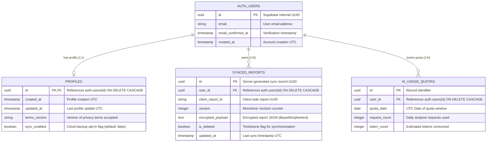
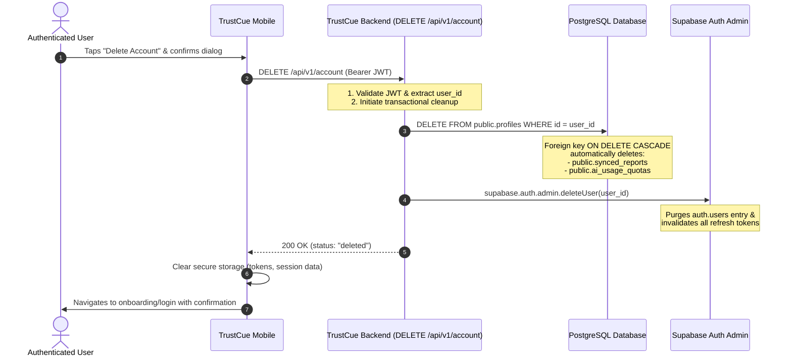

# TrustCue Database & Authentication Design

## 1. Managed Authentication Identity Model

TrustCue delegates authentication, password management, password hashing (bcrypt/Argon2), email verification, and session token issuance entirely to **Supabase Auth** (an open-source GoTrue implementation).

### 1.1 Key Architectural Commitments:
1. **Zero Password Storage in Application Tables:** Passwords never touch the TrustCue backend service or application database tables.
2. **Stable Identifier:** All ownership and foreign-key relations bind strictly to the immutable UUID (`auth.users.id`). The user's display email is never treated as an authorization key.
3. **Data Minimization:** No personal information beyond the user's email address and timestamp metadata is collected or stored.
4. **Client-Side Token Handling:** The mobile client communicates directly with Supabase Auth for login, signup, and token refreshes using PKCE (Proof Key for Code Exchange). It presents the issued JWT to the TrustCue backend via standard HTTP Bearer authorization headers.

---

## 2. Conceptual Database Entity Design

*(Note: Executable PostgreSQL DDL migrations and schema definitions belong to Module 29 on the `database` branch. This document establishes the conceptual entity model and ownership boundaries.)*



---

## 3. Entity Definitions & Ownership Boundaries

### 3.1 `public.profiles`
- **Purpose:** Minimal application-level metadata attached to authenticated users.
- **Fields:**
  - `id` (`UUID`): Primary key, strictly references `auth.users(id)` with `ON DELETE CASCADE`.
  - `created_at` (`TIMESTAMPTZ`): UTC timestamp of record creation.
  - `updated_at` (`TIMESTAMPTZ`): UTC timestamp of last record update.
  - `terms_version` (`TEXT`): Records version string of terms/privacy policy acknowledged (e.g., `'1.0.0'`).
  - `sync_enabled` (`BOOLEAN`): Explicit opt-in flag for account-owned cloud backup. Defaults strictly to `FALSE`.

### 3.2 `public.synced_reports` (Planned for Module 39)
- **Purpose:** Storage for user-opted cloud report backups.
- **Invariants:**
  - Local SQLite report history remains the primary and default datastore (Module 36).
  - Reports are synchronized to the cloud **ONLY** if the user explicitly enables backup/sync in settings.
  - Payloads are stored as encrypted blobs (`encrypted_payload`) using client-side or envelope encryption, ensuring the server cannot read stored user reports in cleartext.
  - `is_deleted` serves as a synchronization tombstone to propagate deletions across multiple user devices without retaining sensitive content.

### 3.3 `public.ai_usage_quotas`
- **Purpose:** Enforce fair-use rate limits and fail-closed quotas on the free-tier AI API.
- **Invariants:**
  - Aggregates daily requests per `user_id` and `quota_date` (UTC).
  - Prevents runaway abuse by capping requests (e.g., max 20 requests per day per user).
  - Records older than 30 days are automatically pruned via periodic maintenance.

---

## 4. Row Level Security (RLS) & Access Control

PostgreSQL Row Level Security (RLS) is enabled on all tables in the `public` schema.

### 4.1 RLS Policies

```sql
-- Profiles: Users can only read and update their own profile
CREATE POLICY "Users can view own profile"
  ON public.profiles FOR SELECT
  USING (auth.uid() = id);

CREATE POLICY "Users can update own profile"
  ON public.profiles FOR UPDATE
  USING (auth.uid() = id);

-- Synced Reports: Complete user isolation
CREATE POLICY "Users can view own synced reports"
  ON public.synced_reports FOR SELECT
  USING (auth.uid() = user_id);

CREATE POLICY "Users can insert own synced reports"
  ON public.synced_reports FOR INSERT
  WITH CHECK (auth.uid() = user_id);

CREATE POLICY "Users can update own synced reports"
  ON public.synced_reports FOR UPDATE
  USING (auth.uid() = user_id);

CREATE POLICY "Users can delete own synced reports"
  ON public.synced_reports FOR DELETE
  USING (auth.uid() = user_id);

-- Quotas: Read-only for users; backend service role manages increments
CREATE POLICY "Users can view own quota"
  ON public.ai_usage_quotas FOR SELECT
  USING (auth.uid() = user_id);
```

---

## 5. Account Deletion Lifecycle & Data Purge

TrustCue upholds the fundamental privacy right of account deletion. When an account deletion is requested:



No orphan records, soft-deleted user content, or cached auth sessions remain after deletion.

---

## 6. Backend Session Validation Architecture (Module 30)

The backend service validates Supabase session tokens statelessly using cryptographic signature verification without requiring synchronous round-trips to the Supabase Auth server on every request:

1. **Algorithm & Key Support:** Supports HMAC-SHA256 (`HS256`) shared secret verification via `SUPABASE_JWT_SECRET` and RSA/ECDSA public key validation via `SUPABASE_JWKS_URL`.
2. **Subject UUID Enforcement:** Extracts `sub` claim and strictly validates that it conforms to RFC 4122 UUID format. Non-UUID subjects are rejected with HTTP 401.
3. **Role Discrimination:** Rejects public anonymous tokens (`role: "anon"` or `aud: "anon"`). Protected endpoints strictly require `role: "authenticated"` or higher privilege.
4. **Temporal Bounds:** Enforces token expiration (`exp`) and not-before (`nbf`) claims. Expired tokens return HTTP 401 with standard code `"token_expired"`.
5. **Audience & Issuer Enforcement:** Validates `aud: "authenticated"` and optional project-specific issuer (`iss`). Mismatched issuers return HTTP 401 with code `"invalid_issuer"`.
6. **Privacy-Preserving Rejection:** Token validation failures return sanitized `ErrorEnvelope` payloads. Cryptographic secrets, signing key fingerprints, and internal stack traces are never exposed in error responses.
7. **Production Integrity Guard:** Synthetic test keys (`test-jwt-secret-key-...`) and bypass modes are strictly prohibited and actively rejected when `ENVIRONMENT="production"`.
