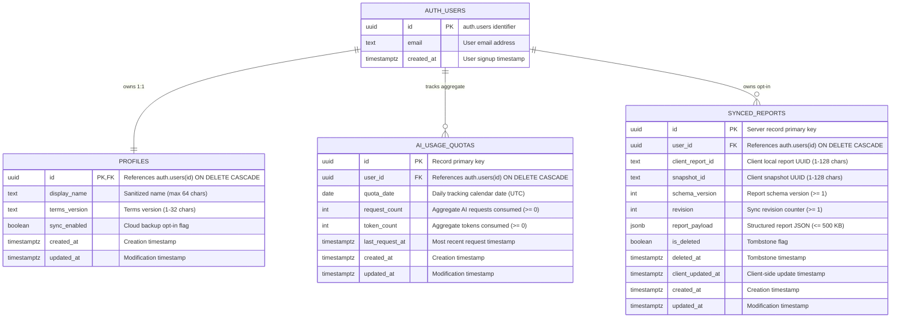

# TrustCue Database Architecture & Ownership Policies

This document specifies the database architecture, entity relationships, security policies, and privacy invariants for TrustCue's PostgreSQL database schema implemented in Module 29.

---

## 1. System Overview

TrustCue adopts a **local-first privacy architecture**. The database does not store user conversations, raw text snippets, prompt transcripts, or message hashes. The cloud database is strictly reserved for:
1. **User Profiles & Privacy Preferences**: Account-level configuration and terms acceptance.
2. **Operational AI Usage Quotas**: Server-managed rate limit counters to fail-closed against quota abuse.
3. **Optional Encrypted Report Backups**: Explicitly opt-in client report snapshots, strictly bounded in payload size.

All tables are placed in the `public` schema and enforce PostgreSQL **Row Level Security (RLS)** with forced execution for all non-administrative roles.

---

## 2. Entity-Relationship Model



---

## 3. Table Specifications & Invariants

### 3.1 `public.profiles`
- **Purpose**: Holds account preferences and terms agreement linked 1:1 to `auth.users`.
- **Primary Key**: `id UUID REFERENCES auth.users(id) ON DELETE CASCADE`.
- **Invariants**:
  - `chk_profile_display_name_len`: `display_name IS NULL OR (char_length(display_name) <= 64 AND display_name ~ '^\S(.*\S)?$')`.
  - `chk_profile_terms_version_len`: `char_length(terms_version) BETWEEN 1 AND 32`.
  - `sync_enabled`: Default `FALSE`. Requires explicit opt-in before client synchronizes reports.
  - `sync_generation`: Monotonically increasing counter incremented on each cloud purge to invalidate stale client uploads.
  - `sync_purged_at`: UTC timestamp recording when cloud backup was last purged.
  - Zero sensitive auth tokens or passwords stored.

### 3.2 `public.ai_usage_quotas`
- **Purpose**: Operational rate-limiting datastore tracking daily AI API usage.
- **Primary Key**: `id UUID DEFAULT gen_random_uuid()`.
- **Unique Constraint**: `uq_ai_usage_quotas_user_date UNIQUE (user_id, quota_date)`.
- **Invariants**:
  - `chk_quotas_requests_non_negative`: `request_count >= 0`.
  - `chk_quotas_tokens_non_negative`: `token_count >= 0`.
  - **Zero Content Storage**: The schema contains zero prompt text, message text, evidence excerpts, or content hashes.

### 3.3 `public.synced_reports`
- **Purpose**: Optional encrypted cloud backup for local scam analysis reports.
- **Primary Key**: `id UUID DEFAULT gen_random_uuid()`.
- **Unique Constraint**: `uq_synced_reports_user_report UNIQUE (user_id, client_report_id)`.
- **Invariants**:
  - `chk_report_payload_size`: `octet_length(report_payload::text) <= 500000` (~500 KB limit).
  - `chk_tombstone_consistency`: `(is_deleted = FALSE AND deleted_at IS NULL) OR (is_deleted = TRUE AND deleted_at IS NOT NULL)`.
  - `chk_report_payload_privacy`: Strict JSON key allowlist ensuring only `formatVersion`, `outcomeState`, `hasAiAnalysis`, `indicatorCount`, `categories`, and `source` are stored for active reports. Forbids raw message text, excerpts, screenshots, and hashes.
  - No raw images, screenshots, or unredacted binary artifacts permitted.

---

## 4. Permission Matrix & Access Control

Default privileges on schema `public` are revoked from `PUBLIC` and `anon`. All access must be granted explicitly.

| Table | Role `anon` | Role `authenticated` | Role `service_role` (Backend) |
| :--- | :--- | :--- | :--- |
| `public.profiles` | **DENIED** | `SELECT`, `INSERT`, `UPDATE` (own row via `auth.uid() = id`) | Full CRUD (bypasses RLS) |
| `public.ai_usage_quotas` | **DENIED** | `SELECT` (own row via `auth.uid() = user_id`, **READ-ONLY**) | Full CRUD (atomic increments) |
| `public.synced_reports` | **DENIED** | Full CRUD (own row via `auth.uid() = user_id`) | Full CRUD |

### Strict RLS Policy Invariants
1. **Force Row Level Security**: `FORCE ROW LEVEL SECURITY` is applied to all tables to guarantee policies apply even to table owners if querying without `service_role`.
2. **Quota Tamper Protection**: The `authenticated` role has **zero** `INSERT`, `UPDATE`, or `DELETE` privileges on `public.ai_usage_quotas`. Only the backend server utilizing the `service_role` key can increment or modify usage quotas.
3. **Identity Spoofing Prevention**: All `UPDATE` policies define identical `USING` and `WITH CHECK` clauses. This prevents an authenticated user from transferring ownership of a row to another `user_id`.

---

## 5. Operational Patterns

### 5.1 Atomic Quota Enforcement Algorithm
To prevent race conditions when multiple client requests arrive concurrently, quota tracking employs an atomic `UPSERT` on the backend:

```sql
INSERT INTO public.ai_usage_quotas (
    user_id, quota_date, request_count, token_count, last_request_at
) VALUES (
    $1, CURRENT_DATE, 1, $2, now()
)
ON CONFLICT (user_id, quota_date) DO UPDATE
SET
    request_count = public.ai_usage_quotas.request_count + 1,
    token_count = public.ai_usage_quotas.token_count + EXCLUDED.token_count,
    last_request_at = now(),
    updated_at = now()
RETURNING request_count, token_count;
```

If the returned `request_count` exceeds the daily limit (e.g. 5 requests/day for standard users), the backend halts processing and raises `429 Too Many Requests`.

### 5.2 Synchronization & Tombstoning Strategy
1. **Local-First Precedence**: Reports are authored and stored on-device first.
2. **Opt-In Gate**: Synchronization is only performed if `profiles.sync_enabled == TRUE`.
3. **Monotonic Revisions**: Each report update increments `revision`. If a conflict occurs, the server compares `client_updated_at` and `revision`.
4. **Soft-Delete Tombstoning**: Deleted reports on the client set `is_deleted = TRUE` and record `deleted_at = now()`. The database constraint `chk_tombstone_consistency` ensures invalid tombstone states cannot be persisted.

---

## 6. Cascade Deletion & Account Erasure

In compliance with data protection principles and user autonomy, account deletion is fail-safe:
- Deleting a user row from `auth.users` triggers `ON DELETE CASCADE` across:
  - `public.profiles`
  - `public.ai_usage_quotas`
  - `public.synced_reports`
- Verification suite `tests/sql/04_test_cascade_deletion.sql` guarantees zero orphan rows remain after user account deletion.
