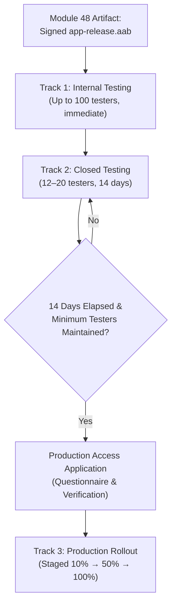

# TrustCue App Access Instructions and Testing Track Strategy (Module 49)

## Executive Summary
This document provides the operational guide for Google Play Console submission under **Module 49: Play Console Listing, Disclosures, and Testing Tracks**. It specifies:
1. Exact **App Access** review instructions for Google Play policy reviewers.
2. A comprehensive **Testing Track Strategy** covering Internal Testing, Closed Testing (14-day tester requirements), and Production readiness.
3. An explicit **Owner-Only Action Register** delineating human legal/financial responsibilities from automated development deliverables.

---

## 1. Google Play Console: App Access Review Instructions

Under Google Play Policy (`Policy -> App access`), developers must provide clear instructions and working credentials so automated reviewers and human policy teams can validate every restricted workflow.

### 1.1 Unrestricted Workflows (Guest Mode - No Login Required)
Over 80% of TrustCue's functionality is accessible immediately upon launch without requiring an account or login:
- **Message Text Input & Normalization:** Pasting or typing messages up to 10,000 characters (`/input/text`).
- **Screenshot OCR Text Extraction:** Local image selection and optical character recognition using Google ML Kit Latin models (`/input/screenshot`).
- **Link & QR Destination Inspection:** Offline structural analysis of URLs, Punycode host decoding, and QR code reading (`/input/link`).
- **Sensitive Data Detection & Local Redaction:** Real-time on-device scanning for phone numbers, emails, and verification codes (`/input/review`).
- **Deterministic 10-Rule Scam Analysis Engine:** Local pattern evaluation producing evidence citations with exact character offsets (`/analysis/results`).
- **Local SQLite History:** Sandboxed local report persistence, full-text search with `ESCAPE '\'`, metadata filtering, and single-report deletion (`/history`).
- **Privacy-Reviewed Export:** Pure-local Plain Text (`.txt`) and paginated PDF (`.pdf`) report generation with customizable redactions.
- **Educational Library:** All 10 indicator categories with positive/negative examples and safety advice (`/education`).
- **Bilingual Interface:** Instant switching between English (`en_US`) and Urdu (`ur_PK`).

### 1.2 Restricted Workflows (Requires Test Account)
The following cloud-connected features require authentication:
- **Consented Cloud AI Analysis:** Secondary linguistic pretexting evaluation powered by Groq Cloud models (`POST /api/v1/analysis/ai`).
- **Daily AI Quota Tracking:** Verification of fair-usage daily quota decrement from 15 requests/day (`ai_usage_quotas` table).
- **Cloud Report Synchronization:** Metadata-only report sync (`POST/GET /api/v1/sync/reports`).
- **Cloud Backup Purge:** Instant deletion of all synced cloud metadata (`DELETE /api/v1/sync/reports`).
- **Account Profile Management:** Editing user display name (`PATCH /api/v1/account/profile`).
- **In-App Account Deletion:** Atomic cascade deletion of all user cloud records (`DELETE /api/v1/account`).

### 1.3 Exact Form Submission Template for Play Console
In the Google Play Console under **Policy > App content > App access**:
1. Select: **"All or some functionality is restricted"**.
2. Click **+ Add new instructions** and input:

| Form Field | Recommended Entry |
|---|---|
| **Title / Name** | `General Reviewer Access (Guest & Registered)` |
| **Username / Email** | `[OWNER_CONFIGURED_TEST_EMAIL]` *(e.g. `play_reviewer@trustcue.internal`)* |
| **Password** | `[OWNER_CONFIGURED_TEST_PASSWORD]` |
| **Any other instructions / 2FA** | See below instructions text |

**Instructions Text for Reviewer:**
```text
TrustCue operates in two tiers:
1. GUEST MODE (Default): All core features—message input, on-device OCR, link inspection, sensitive data redaction, 10-rule scam analysis, evidence trails, SQLite history, and PDF/Text export—require NO login. Reviewers may test these features freely as a guest without signing in.
2. AUTHENTICATED MODE: To test optional features (Consented Cloud AI analysis, Quotas, Cloud Sync, and Account Deletion), tap the "Account" button in the top navigation bar. Enter the test email and password provided above.
Note: The test account is pre-verified. No SMS 2FA is required. Cloud AI analysis requires affirmative user consent on each request before submitting text to our hosted FastAPI backend.
```

> [!IMPORTANT]
> **Secret Protection & Auto-Confirm Requirement:**
> Reviewer passwords and private API keys must **never** be committed to Git or documentation.
> Because non-deliverable internal domains (e.g. `@trustcue.internal`) cannot receive external emails, the repository owner must create the test user directly in the Supabase Dashboard:
> 1. In Supabase Dashboard, navigate to **Authentication -> Users**.
> 2. Click **Add User -> Create User**.
> 3. Enter email: `play_reviewer@trustcue.internal` (or an owner-controlled test address).
> 4. Enter a strong, private password.
> 5. Ensure **"Auto Confirm User?" / "Confirm Email"** is toggled **ON**. This sets `email_confirmed_at` immediately upon creation, allowing Google Play reviewers to log in instantly without waiting for or receiving an email verification link.
> 6. Input these credentials directly into the private Google Play Console App Access form.

---

## 2. Testing Track Strategy & Lifecycle



### 2.1 Track 1: Internal Testing Track
- **Purpose:** Smoke test production AAB installation, asset rendering, and Play feature delivery immediately without waiting for standard Google policy review.
- **Capacity:** Up to 100 internal email testers.
- **Turnaround:** Available within minutes of bundle upload.
- **Execution Steps:**
  1. In Play Console, navigate to **Release > Testing > Internal testing**.
  2. Create a new release and upload `build/app/outputs/bundle/release/app-release.aab`.
  3. Create an internal tester email list containing the project owner and trusted team members.
  4. Distribute the opt-in URL to download and verify the build on physical devices.

### 2.2 Track 2: Closed Testing Track (Personal Developer Accounts)
- **Applicability:** Mandatory for all personal developer accounts created after November 13, 2023.
- **Requirement:** A minimum of **12 to 20 unique testers** must remain continuously opted in for **14 consecutive days**.
- **Buffer Recommendation:** Recruit at least 15–20 testers to ensure that if any tester uninstalls or opts out, the active count never drops below 12 (which would reset the 14-day clock).
- **Tester Engagement:** Testers should open the app periodically, test local scam analysis, and submit constructive feedback via the Play Store feedback channel or designated email.
- **Update Cadence:** Deploying at least one minor revision during the 14-day window demonstrates active developer maintenance and satisfies Google's review algorithm.

### 2.3 Track 3: Production Access Application
Once the 14 consecutive days conclude:
1. The **Apply for Production** button becomes active in the Play Console.
2. Complete the Google questionnaire detailing:
   - How testers were recruited.
   - Summaries of tester feedback received.
   - Specific app improvements and bug fixes applied during testing.
   - Why the application is stable and ready for public production.
3. Following approval, promote the build to the **Production track** with staged rollouts (e.g. 10%, 25%, 50%, 100%).

---

## 3. Centralized Owner-Only Action Register

In strict adherence to the project boundary rules (no developer account fees, no unauthorized publishing, zero financial expenditure), all tasks requiring account ownership and legal authority are explicitly cataloged below:

| Action ID | Domain | Responsibility / Action | Status / Prerequisite |
|---|---|---|---|
| **OWN-00** | Cryptographic Key Backup | Execute verified AES-256 encrypted backup of `upload-keystore.jks` and `key.properties` to external physical media outside the laptop using OpenSSL with PBKDF2: `tar -czf - upload-keystore.jks key.properties \| & "C:\Program Files\Git\usr\bin\openssl.exe" enc -aes-256-cbc -salt -pbkdf2 -out <destination>\trustcue_signing_backup.tar.gz.enc`. The tool prompts interactively for an encryption password without echoing or saving it in command logs. Note: standard Windows ZIP does not encrypt files, and ordinary cloud sync is not client-side encrypted by default. | Pending Owner Execution & Confirmation |
| **OWN-01** | Developer Registration | Register personal or organizational Google Play Developer account ($25 one-time Google fee). | Owner Action (Outside codebase) |
| **OWN-02** | Identity Verification | Complete Google identity verification (Government ID, legal name, address verification). | Owner Action |
| **OWN-03** | Web Resource Hosting | Publish `docs/privacy/privacy_policy.html` and `account_deletion.html` to a public URL (e.g. GitHub Pages at `https://<username>.github.io/trustcue-mobile/privacy/...`). | Prepared in repo; pending owner publish |
| **OWN-04** | Play Console Store Listing | Copy metadata and upload graphic assets from `docs/store_assets/` into Play Console. | Prepared in repo; pending owner submission |
| **OWN-05** | Data Safety Declarations | Fill out the Play Console Data Safety questionnaire using `docs/DATA_SAFETY_AND_DISCLOSURES_MODULE_49.md`. | Prepared in repo; pending owner submission |
| **OWN-06** | App Access Setup | Create test reviewer account in Supabase Dashboard and input credentials into Play Console App Access form. | Prepared in repo; pending owner input |
| **OWN-07** | AAB Upload (Internal Track) | Upload `app-release.aab` to Internal Testing track. | Built & verified; pending owner upload |
| **OWN-08** | Closed Testing Enrollment | Recruit 15–20 testers, configure Closed Testing track, and maintain for 14 days. | Pending owner activation |
| **OWN-09** | Production Application | Submit production access application questionnaire after 14 days of closed testing. | Future owner gate |

