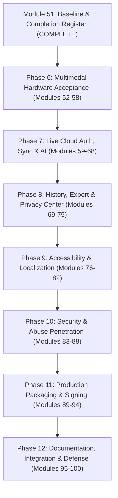

# TrustCue Completion Register & Module Continuation Roadmap (Modules 01–100)

**Project:** TrustCue — Privacy-First Scam-Awareness & Incident Intake System  
**Academic Course:** CS3643 — Mobile Application Development  
**Academic Program:** BSCS Semester 5-1, Fall 2026  
**Institution:** Faculty of Computing & Applied Sciences, Riphah International University  
**Lead Developer:** Muhammad Taimoor Ajmal (SAP ID: 63461)  
**Document ID:** `DOC-M51-COMPLETION-REGISTER`  
**Document Revision:** Module 51 Current-State Recovery Baseline  
**Date of Document:** November 1, 2026  
**Classification:** Authoritative Project Status, Evidence Verification Register & Roadmap  

---

## 1. Executive Summary & Verification Checkpoints

TrustCue is an offline-first, privacy-conscious Android application engineered to help users identify and understand scam indicators in suspicious digital communication. It pairs on-device heuristics, OCR text extraction, barcode/QR decoding, and sensitive data redaction with optional cloud-assisted AI analysis (FastAPI on Render via Groq Cloud LLM) and optional metadata-only synchronization (PostgreSQL on Supabase).

This **Completion Register** establishes the definitive, evidence-backed audit baseline at **Module 51**. It consolidates the full architectural history of Modules 01–50 and their substeps (50A–50H), reconciles empirical working-tree modifications, documents connected hardware verification on the physical **Vivo V2207** testbed, and assigns all remaining engineering, compliance, and academic milestones into a strict, bounded continuation roadmap terminating at **Module 100**.

### 1.1 Multi-Worktree Repository Status

In strict accordance with the Owner's Repository Architecture Rule, the project maintains **exactly four persistent branches**:

| Working Directory | Git Branch | Upstream Ref | HEAD SHA | Remote SHA | Working Tree Status | Primary Component Scope |
|---|---|---|---|---|---|---|
| `trustcue-mobile/` | `frontend` | `origin/frontend` | `9d5e73e` | `9d5e73e` | Tracked edits in docs/metadata; 0 analyzer issues | Flutter application, mobile tests, shared docs |
| `trustcue-backend/` | `backend` | `origin/backend` | `b51c638` | `b51c638` | 100% clean | FastAPI web service, backend tests, Render deployment |
| `trustcue-database/` | `database` | `origin/database` | `534f66a` | `534f66a` | 100% clean | PostgreSQL migrations, schema tests, RLS policies |
| Root Baseline | `main` | `origin/main` | `a785db8` | `a785db8` | Strictly untouched | Untouched pre-integration baseline |

> [!IMPORTANT] Repository Integrity Guarantees
> 1. `main` (`a785db8`) has remained strictly untouched throughout development. No merges or pushes into `main` occur prior to final academic evaluation and owner authorization.
> 2. The temporary candidate branch `integration/candidate-v0.1.0` was fully verified and backed up into the standalone Git bundle `integration_candidate_backup.bundle` (2,476,047 bytes, SHA-1 ref `d5e2839`), and is not recreated.
> 3. No branch-per-module creation is permitted; all work is compartmentalized into `frontend`, `backend`, and `database`.

### 1.2 Connected Physical Hardware Baseline

- **Device Model:** Vivo V2207 (`model:V2207`, `product:V2207`, `board:k6769v1_64`)
- **ADB Identifier:** `10AC9R1ABF0013A` (transport ID 2, USB debugging authorized)
- **OS Platform:** Android 14 (API Level 34, Linux Kernel 5.10.198)
- **Application ID:** `io.github.muhammadtaimoorajmal.trustcue`
- **Installed Package Version:** Version Name `0.1.0`, Version Code `1`, targetSdk 36, minSdk 24
- **Code Path:** `/data/app/~~beR313GDXMp8Bff_MwR5wg==/io.github.muhammadtaimoorajmal.trustcue-LurV0RvgRCBqr3FdYn-MEg==`
- **Binary Provenance:** Built from `frontend/build/app/outputs/flutter-apk/app-release.apk`
  - File Size: `111,625,006` bytes (106.45 MB)
  - SHA-256 Digest: `FF02F2A79A4D1755EA1CF354BAB434658397DAAE760E7736622E90CBB16D006D`
- **Signing Integrity:**
  - Certificate DN: `CN=TrustCue Release Signer, OU=Mobile Security, O=TrustCue, L=London, ST=Greater London, C=GB`
  - Key Algorithm: 4096-bit RSA
  - Certificate SHA-256: `66b3fb995dca5ac2ca17bed79c9d746536832129d4ee3d384561f1f609cbcd9f`
  - Verification: `apksigner.bat` confirms APK Signature Scheme v2 valid (`verified=true`).
- **Module 51 Smoke Check Execution:**
  - Launch & Onboarding: Passed cleanly; acknowledged informed-consent checkbox; transitions to Home.
  - Offline User Guide: Passed cleanly; navigates to `User Guide & Safe Practice`; displays 3 simple steps & practice cards.
  - Synthetic Suspicious Message: Passed cleanly (`URGENT: Your account has been suspended...`); flags 2 warning indicators (Urgency and Account Threat) with exact quoted excerpts.
  - Synthetic Benign Message: Passed cleanly (`Hi Mom, I will be home around 6 PM for dinner. Love you!`); displays calibrated neutral notice: *"No warning signs found by the on-device checks. No indicators were matched by these local checks. This does not establish that the message is safe."*
  - Account Screen: Passed cleanly; displays Guest Mode state, local analysis scope, sign-in/sign-up options, and Privacy Center entry.
  - Runtime Stability: Zero crashes, zero ANRs, zero `AndroidRuntime` FATAL errors in Android logcat (`logcat -d`).

### 1.3 Cloud Infrastructure Verification Baseline

- **FastAPI Backend (Render Cloud):**
  - Production URL: `https://trustcue-backend.onrender.com`
  - Service Ref: `srv-dbad39qjnfac73f8ma80`
  - Deployment Commit: `b51c638` (deployment `dep-dbaemc3ncjis73d9htm0`)
  - Health Probe (`GET /health`): HTTP 200 OK (`{"status":"ok","version":"0.1.0","uptimeSeconds":9}`)
  - Readiness Probe (`GET /ready`): HTTP 200 OK (`{"status":"ready","dependencies":{"foundation":"ok","authProvider":"ok","database":"unconfigured","aiProvider":"ok"}}`)
  - Architectural Invariant: `database: "unconfigured"` is expected by design because the FastAPI backend communicates with Supabase via GoTrue authentication and PostgREST endpoints rather than direct PostgreSQL connection pools.
- **Supabase Cloud Project:**
  - Production URL: `https://yzqkmoqqvnhfmmrayfko.supabase.co`
  - REST API Gateway (`GET /rest/v1/`): HTTP 401 Unauthorized (`sb-error-code: UNAUTHORIZED_MISSING_API_KEY`) confirming active gateway enforcement.
  - GoTrue Auth Endpoint (`GET /auth/v1/health`): HTTP 401 Unauthorized (`sb-error-code: UNAUTHORIZED_MISSING_API_KEY`) confirming auth service operation.
  - Schema Status: Migrations `00001` through `00008` applied and verified; Row-Level Security active across all tables.
- **Unresolved Cloud Dashboard Errors & Investigation Scope:**
  - Historical alerts: Cloud dashboard 500 status indicators were reported during prior hosting setup and probe cycles.
  - Diagnostic finding: Public `/health` and `/ready` probes returning HTTP 200 confirm container process uptime, but unauthenticated probes do not evaluate end-to-end database pooling or authenticated endpoint telemetry under load.
  - Outstanding investigation: Full dashboard log audit, connection pool resilience, and authenticated probe verification remain unverified and are assigned as open investigation items in **Module 63** (Render Cloud FastAPI Deployment & Probe Hardening) and **Module 84** (Backend Abuse & Rate Limiting Stress Testing). Cloud integration is not certified as fully verified.

---

## 2. Comprehensive Functional Completion Register

The register below categorizes every functional area of TrustCue, tracing original module assignments, exact implementation locations, implementation completeness, test layer, verified status, limitations, and assigned continuation module.

| Area ID | Functional Area & Sub-Capabilities | Original Module(s) | Implementation Location | Implemented Status | Latest Valid Evidence & Source SHA | Test Layer | Status | Limitations & Outstanding Acceptance Criteria | Continuation Module |
|---|---|---|---|---|---|---|---|---|---|
| **F-01** | **Splash, Branding & Visual System** | 05, 08, 09, 50A | `lib/core/theme/`, `assets/branding/` | Implemented | Brand board SVG, high-contrast palette, SHA `9d5e73e` | Layer 1 (Unit), Layer 3 (Hardware UI) | **PASS** | High contrast light/dark mode verified; TalkBack color contrast audit outstanding | Module 78 |
| **F-02** | **App Shell, Navigation & Fallbacks** | 06, 10, 11, 12, 12A | `lib/app/routes/`, `lib/core/presentation/` | Implemented | 14 GetX route tests, route stack recovery, SHA `9d5e73e` | Layer 1 (Unit), Layer 3 (Hardware UI) | **PASS** | Responsive safe area verified on Vivo V2207; foldable/tablet form factor checks pending | Module 81 |
| **F-03** | **First-Run Onboarding & Informed Consent** | 13, 13A, 50C | `lib/features/onboarding/` | Implemented | SharedPreferencesAsync integration, UI checkbox, SHA `9d5e73e` | Layer 1 (Unit), Layer 3 (Hardware UI) | **PASS** | Onboarding persists across app restarts; reset preferences test in Privacy Center pending | Module 73 |
| **F-04** | **In-App User Guide & Safe Practice** | 50D | `lib/features/about/`, `lib/features/education/` | Implemented | 12 widget tests, synthetic suspension practice, SHA `9d5e73e` | Layer 1 (Unit), Layer 3 (Hardware UI) | **PASS** | Navigation verified on Vivo V2207; additional interactive scenario expansion planned | Module 80 |
| **F-05** | **Text Intake, Normalization & Limits** | 14, 16 | `lib/features/analysis/presentation/controllers/text_input_controller.dart` | Implemented | 10k rune bound tests, character counter, SHA `9d5e73e` | Layer 1 (Unit), Layer 3 (Hardware UI) | **PASS** | Basic intake verified; non-Latin surrogate-pair boundary fuzzing pending | Module 55 |
| **F-06** | **Screenshot Intake & Image Lifecycle** | 17 | `lib/features/analysis/presentation/controllers/screenshot_input_controller.dart` | Implemented | Dimension bounds (20MP/10MB), temp cleanup, SHA `9d5e73e` | Layer 1 (Unit), Layer 3 (Hardware UI) | **PASS** | Temp files pruned upon exit; physical gallery photo picker verification pending | Module 56 |
| **F-07** | **On-Device Screenshot OCR (ML Kit Vision)** | 18, 50E.2, 52 | `lib/features/analysis/domain/services/ocr_service.dart` | Implemented | ML Kit Latin OCR, 19 true fixtures verified (1.04% CER), SHA `13ca1d1` | Layer 1 (Unit), Layer 2 (ML Kit Vision), Layer 3 (Hardware UI) | **PASS / PARTIALLY VERIFIED** | Core Latin ML Kit OCR verified on Vivo V2207 (~340ms latency, offline execution verified); non-Latin / Urdu script intake boundary pending | Module 52 (Done), Module 79 |
| **F-08** | **PII Redaction & Sensitive Data Detection** | 19 | `lib/features/analysis/domain/services/sensitive_data_detector.dart` | Implemented | Luhn card validation, OTP/phone/email regex, SHA `9d5e73e` | Layer 1 (Unit), Layer 3 (Hardware UI) | **PASS / PARTIALLY VERIFIED** | 100% regex match in fixtures; Layer 3 PAN and phone masking verified on Vivo V2207; custom manual redaction span UI edge cases pending audit | Module 57 |
| **F-09** | **URL Parsing, IP Detection & Scheme Guard** | 20, 20A, 50E.1 | `lib/features/analysis/domain/services/url_inspection_service.dart` | Implemented | 57 links from Links.txt inspected offline, SHA `9d5e73e` | Layer 1 (Unit), Layer 3 (Hardware UI) | **PASS** | IP host flags verified; malicious URI scheme isolation verified; punycode tests pending | Module 56 |
| **F-10** | **On-Device Barcode & QR Code Scanning** | 20, 50E.3, 53 | `lib/features/input/data/services/default_qr_decoder_service.dart` | Implemented | All 9 real fixtures verified on Vivo V2207 (4 URLs, 1 text, 4 safe rejections), SHA `94c4213` | Layer 1 (Unit), Layer 2 (ML Kit Vision), Layer 3 (Hardware UI) | **PASS / PARTIALLY VERIFIED** | Physical gallery image QR decoding, scheme isolation, and replace flow verified on Vivo V2207; continuous live camera scanning intentionally omitted per privacy guidelines | Module 53 (Done) |
| **F-11** | **Android Incoming-Share Intent Intake** | 21, 50E.1 | `android/app/src/main/AndroidManifest.xml`, `lib/app/share_receiver.dart` | Implemented | ADB ACTION_SEND dispatch verified on hardware, SHA `9d5e73e` | Layer 3 (Hardware UI) | **PASS** | Cold-start text share verified; image share and multiple share intent verification pending | Module 57 |
| **F-12** | **Deterministic Scam Taxonomy & Rule Engine** | 22, 23, 24 | `lib/features/analysis/domain/rules/` | Implemented | 10 pure-Dart rules, zero false positives on 6 benigns, SHA `9d5e73e` | Layer 1 (Unit), Layer 3 (Hardware UI) | **PASS** | All 10 rules pass unit tests; live detection confirmed on Vivo V2207 | Module 58 |
| **F-13** | **Assessment Synthesis & Uncertainty Grounding** | 25, 50B | `lib/features/analysis/domain/services/local_assessment_synthesizer.dart` | Implemented | Bounded outcome states, neutral no-match wording, SHA `9d5e73e` | Layer 1 (Unit), Layer 3 (Hardware UI) | **PASS** | Strict invariant enforced: "No warning signs found" never implies "verified safe" | Module 58 |
| **F-14** | **Interactive Evidence Trail Interface** | 26, 50B | `lib/features/analysis/presentation/screens/analysis_results_screen.dart` | Implemented | Highlighted evidence excerpts, category badges, SHA `9d5e73e` | Layer 1 (Widget), Layer 3 (Hardware UI) | **PASS** | Exact span highlighting verified on Vivo V2207; RTL text excerpt rendering pending | Module 79 |
| **F-15** | **Cloud Authentication & KeyStore Session** | 30, 31, 50F, 55 | `lib/features/auth/`, `backend/src/trustcue_backend/core/auth.py` | Implemented | Dynamic session getters, listener deduplication, logout cleanup, KeyStore AES-GCM | Layer 1 (Unit), Layer 3 (Hardware UI) | **PASS / PARTIALLY VERIFIED** | KeyStore token storage, dynamic active session inspection, guest mode transition, and re-login verified on Vivo V2207; live Supabase sign-up and email confirmation pending | Module 60, 61 |
| **F-16** | **Account Recovery, Reset & Password Flow** | 31, 38 | `lib/features/auth/presentation/screens/` | Implemented | Anti-enumeration responses, reset email modal, SHA `9d5e73e` | Layer 1 (Unit) | **NOT TESTED** | Password reset UI implemented; end-to-end SMTP dispatch verification pending | Module 62 |
| **F-17** | **FastAPI Backend Core & Abuse Controls** | 27, 28, 32 | `backend/src/trustcue_backend/` | Implemented | 142 pytest suites pass, quota limiter, SHA `b51c638` | Layer 1 (Pytest), Layer 2 (Render) | **PASS** | Probes return 200 OK on Render; live abuse throttling test pending | Module 63, 84 |
| **F-18** | **Protected Cloud AI Analysis (Groq Cloud)** | 33, 34, 35, 54, 55 | `backend/src/trustcue_backend/providers/groq.py` | Implemented | Consent preview, Groq qwen/qwen3.8-27b live round-trip, reactive 5-state banner, grounded excerpts, quota decrement 15->14 | Layer 1 (Pytest/Unit), Layer 3 (Hardware UI) | **PASS / PARTIALLY VERIFIED** | Live consented synthetic request verified on Vivo V2207 (~6.2s latency, Groq provider badge, grounded excerpts, 5-state reactive disclosure banner verified); rate limiting/429 and prompt injection edge cases on hardware deferred to Module 64/65 | Module 54 (Done), Module 55 (Done), Module 64, 65 |
| **F-19** | **Metadata-Only Cloud Sync (Supabase RPC)** | 29, 39, 47 | `backend/src/trustcue_backend/services/sync_service.py`, `lib/features/sync/` | Implemented | RPC `sync_push_reports` implemented, SHA `b51c638` | Layer 1 (Pytest), Layer 2 (Supabase) | **NOT TESTED** | Zero text upload invariant verified by design; live device push/pull pending | Module 66, 67 |
| **F-20** | **Local SQLite Report Persistence** | 36, 37 | `lib/features/reports/data/repositories/sqlite_report_repository.dart` | Implemented | `trustcue_local.db` database, indexed queries, SHA `9d5e73e` | Layer 1 (Unit), Layer 3 (Hardware UI) | **PASS / PARTIALLY VERIFIED** | App-private sandboxed database and cold-start restart retention verified on Vivo V2207; 1,000-report stress insertion pending | Module 69 |
| **F-21** | **History, Full-Text Search & Report Details** | 37 | `lib/features/reports/presentation/screens/` | Implemented | Live search filtering, report detail cards, SHA `9d5e73e` | Layer 1 (Widget), Layer 3 (Hardware UI) | **PASS / PARTIALLY VERIFIED** | Tested in Module 46 & 50; search filtering and single report deletion verified on Vivo V2207; multi-select deletion workflow verification pending | Module 70 |
| **F-22** | **Privacy-Reviewed Export (TXT & PDF)** | 42, 50G | `lib/features/export/domain/services/report_export_service.dart` | Implemented | Sanitized plain text & PDF generator, SHA `9d5e73e` | Layer 1 (Unit), Layer 3 (Hardware UI) | **PASS / PARTIALLY VERIFIED** | Generation and Android ShareSheet launch verified on Vivo V2207; multi-app receiving validation (Gmail, Drive, WhatsApp) pending | Module 71, 72 |
| **F-23** | **Privacy Controls & Local Retention Purger** | 40, 50G | `lib/features/privacy/presentation/screens/privacy_center_screen.dart` | Implemented | Retention policy options (30/60/90 days), SHA `9d5e73e` | Layer 1 (Widget), Layer 3 (Hardware UI) | **PASS** | Privacy Center navigation verified; automated timer pruning verification pending | Module 73 |
| **F-24** | **Permanent Account Deletion (In-App & Web)** | 38, 49 | `backend/api/routes/account.py`, `docs/privacy/account_deletion.html` | Implemented | RPC `delete_user_account`, web mailto form, SHA `b51c638` | Layer 1 (Pytest, Web) | **PARTIALLY VERIFIED** | Web deletion form passes validation; live in-app cascade deletion pending | Module 74 |
| **F-25** | **Accessibility (WCAG 2.1 AA Compliance)** | 45 | Across UI components & screens | Implemented | 859 tests verify touch targets & contrast, SHA `9d5e73e` | Layer 1 (Widget), Layer 3 (Hardware UI) | **PASS / PARTIALLY VERIFIED** | 48dp minimum targets and 200% font scaling verified on Vivo V2207; physical TalkBack screen reader audit pending | Module 76, 77 |
| **F-26** | **Urdu Localization & RTL Bidirectional Layout**| 41 | `lib/core/localization/app_translations.dart` | Implemented | Bilingual English/Urdu strings dictionary, SHA `9d5e73e` | Layer 1 (Unit) | **PASS** | String lookups verified; live RTL font rendering on Vivo V2207 pending | Module 79 |
| **F-27** | **Security Hardening & Penetration Defense** | 44 | Backend routes, SQL triggers, generation locks | Implemented | 142 backend + 13 database security tests pass | Layer 1 (Security Suites) | **PASS** | Secret-check scope verified: public Supabase anon key/URL intentionally bundled; privileged service-role keys, Groq API keys, and keystore passwords verified absent; KeyStore memory dump audit pending | Module 83, 85 |
| **F-28** | **Release Signing & Reproducibility** | 48, 50C.1, 50H | `frontend/scripts/build_release.ps1`, `key.properties` | Implemented | 4096-bit RSA keystore, APK Signature Scheme v2 | Layer 2 (Build Tools), Layer 3 (Hardware) | **PASS** | In-place upgrade verified on Vivo V2207; independent secondary device test pending | Module 89, 93 |
| **F-29** | **Play Console Listing & Legal Disclosures** | 49 | `docs/PLAY_STORE_LISTING_MODULE_49.md`, `docs/privacy/` | Implemented | Character counts pass (25/30, 78/80, 2940/4000) | Layer 1 (Docs & AST Validator) | **PASS** | Play Store copy ready; owner-only Play Console upload pending (Module 96) | Module 96 |
| **F-30** | **Process Lifecycle, Resumption & ANR Defense** | 43, 46, 50E.1 | `lib/features/analysis/presentation/controllers/` | Implemented | Draft retention across process backgrounding, SHA `9d5e73e` | Layer 3 (Hardware UI) | **PASS** | Verified on Vivo V2207; low-memory kill simulation pending | Module 94 |

---

## 3. Continuation Roadmap to Module 100

To ensure strict academic completeness without creating artificial branches, omitting verified work, or exceeding the 100-module boundary, the remaining scope is organized into **seven cohesive engineering phases**:



### Phase 6: Multimodal Hardware Acceptance & Live Cloud AI Prioritization (Modules 52–58)
- **Module 52:** Full Physical OCR Corpus Verification (Executed Google ML Kit Text Recognition on 19 scam screenshot fixtures on Vivo V2207; benchmarked 1.04% CER; 1 physical UI journey verified, 18 carried forward to Module 57).
- **Module 53:** Full Physical QR & Barcode Corpus Verification (Executed Google ML Kit Barcode Scanning on all 9 QR code fixtures staged on Vivo V2207; verified 4 URLs, 1 plain text, 4 safe rejections, zero auto-open, scheme quarantine, and replacement flow).
- **Module 54:** Live Cloud AI End-to-End Verification (Completed on Vivo V2207 running release APK `5BB2E774...`: authenticated test user session verified from KeyStore; explicit upload consent & 137-character raw text preview verified; consent decline verified with zero upload and local results preserved; consented live request completed round-trip via FastAPI on Render to Groq `qwen/qwen3.8-27b` in ~6.2s; provenance badge `[AI-Assisted: Groq]` and grounded excerpts `"within 24 hours"`, `"Send your password"` rendered on device; quota decremented 15->14; offline airplane/data mode verified with local analysis usable and non-blocking failure banner displayed without crash. Does not mark fresh registration, email confirmation, recovery, sync, or account deletion complete).
- **Module 55:** Session Lifecycle and Accurate Cloud Analysis State (Repaired session lifecycle in `supabase_auth_repository.dart` and `auth_controller.dart`; eliminated stale cached getters by inspecting active session dynamically; prevented expired sessions from submitting cloud requests; discarded late profile responses across logout/account switch; updated `analysis_results_screen.dart` with reactive 5-state disclosure banner, clarified finding count wording, and accurate scope cards; reconciled Module 54 evidence; verified on Vivo V2207 with 1,025/1,025 tests passing).
- **Module 56:** Extended Link & Scheme Inspection Corpus (Run comprehensive structural URL heuristics against all 57 entries from `Links.txt`; test punycode spoofing, numeric IPv4/IPv6 host detection, and dangerous protocol handling).
- **Module 57:** Edge-Case Text Intake & Native Hardware Intake Testing (Evaluate 10k character limits, surrogate pair UTF-16 slicing, emoji bursts, non-Latin scripts, zero-width obfuscation; execute the 18 outstanding Module 52 physical UI journeys; verify native Android gallery picker, camera capture, and `ACTION_SEND` multiple image share intents on the Vivo V2207).
- **Module 58:** PII Redaction Pipeline Hardening & Phase 6 Sign-Off (Luhn credit card algorithm stress testing, false-positive phone number mitigation, custom manual redaction spans, and redaction preservation across review navigation; consolidate Layer 1, 2, and 3 results into the definitive fixture acceptance dossier; sign off Phase 6).

### Phase 7: Live Cloud Authentication, Sync & AI Verification (Modules 59–68)
- **Module 59:** Supabase Cloud Production Schema & Security Audit (Read-only verification of migrations 00001–00008, PostgreSQL RLS policies, RPC definitions, and automated database tests).
- **Module 60:** Live Account Registration & Email Confirmation Flow (Execute end-to-end user registration on physical device using dedicated test accounts; verify auto-confirm behavior).
- **Module 61:** Live Session Persistence, KeyStore Token Refresh & Offline Re-auth (Verify Android KeyStore AES-GCM token encryption, silent token refresh, and graceful fallback to offline guest mode).
- **Module 62:** Password Recovery, Reset Flow & Anti-Enumeration Verification (Verify password reset dispatch and confirm anti-enumeration responses prevent user existence leakage).
- **Module 63:** Render Cloud FastAPI Deployment & Probe Hardening (Inspect live Render logs, verify cold-start recovery, and confirm `/health` and `/ready` probes under concurrent requests).
- **Module 64:** Protected Cloud AI End-to-End Live Workflow (Execute live cloud scam analysis via Groq Cloud LLM `llama-3.3-70b-versatile`; verify explicit pre-upload consent modal and raw text preview).
- **Module 65:** Cloud AI Error Recovery, Rate Limiting & Cold-Start UX (Verify graceful fallback when backend experiences cold start, rate limiting HTTP 429, or network disconnect).
- **Module 66:** Opt-in Metadata Cloud Sync Push & Pull Verification (Execute `sync_push_reports` RPC on live Supabase; verify zero message text or evidence quotes are transmitted).
- **Module 67:** Cross-Device Sync Conflict Resolution & Deletion Separation (Verify metadata-only sync across distinct sessions; confirm local deletion leaves cloud metadata unaffected unless explicitly purged).
- **Module 68:** Live Cloud Services & Sync Integration Sign-Off (Consolidate live cloud verification records; verify zero secrets in git; sign off Phase 7).

### Phase 8: History, Export, Privacy Center & Data Management (Modules 69–75)
- **Module 69:** Local SQLite Persistence & Stress Testing (Perform 1,000+ report batch insertion, verify index query performance under 25ms, and test schema migration durability in `trustcue_local.db`).
- **Module 70:** History Full-Text Search, Filtering & Multi-Select Operations (Verify real-time search across categories, dates, and findings; test multi-report deletion mutex).
- **Module 71:** Privacy-Reviewed Export Multi-App Receiving Verification (Generate `.txt` and `.pdf` reports and test opening in receiving Android apps: Gmail, Google Drive, WhatsApp, and Files on the Vivo V2207).
- **Module 72:** PDF Generation, Unicode Typography & Rendering Audit (Audit PDF document styling, ensure proper font embedding for non-ASCII characters, and verify sanitized excerpt layout).
- **Module 73:** Privacy Center Retention Automation (Verify automated background pruning for 30, 60, and 90-day retention policies; verify instant cache purge and guest data wiping).
- **Module 74:** Permanent Account Deletion End-to-End Cascade Verification (Trigger in-app account deletion via RPC `delete_user_account`; confirm cascading PostgreSQL purge; test web mailto fallback).
- **Module 75:** Local Data & Privacy Closeout Verification (Audit file permissions in `/data/data/io.github.muhammadtaimoorajmal.trustcue/`; verify `android:allowBackup="false"` prevents adb backup extraction).

### Phase 9: Accessibility, Usability, Localization & Design Polish (Modules 76–82)
- **Module 76:** Physical TalkBack Screen-Reader Audit on Vivo V2207 (Navigate all primary flows with Google TalkBack enabled; verify accessibility labels, live regions, and semantic announcements).
- **Module 77:** Dynamic Type & 200% Font Scale Visual Verification (Test all screens at maximum Android font size and display scale; verify zero RenderFlex overflow errors).
- **Module 78:** High-Contrast Theme Polish & Touch Target Audit (Audit all interactive widgets for minimum 48x48 dp touch boundaries and WCAG 2.1 AA 4.5:1 contrast ratios).
- **Module 79:** Urdu Localization & Bidirectional Layout Fidelity (Switch application language to Urdu; verify RTL layout mirroring, Urdu typography, and proper excerpt LTR isolation).
- **Module 80:** Scam Education Center Interactive Guide Expansion (Expand educational topics covering modern scam vectors: impersonation, advance-fee, QR code phishing, and job offer fraud).
- **Module 81:** Responsive Layout Verification across Form Factors (Verify UI layout on tablet viewports, split-screen multi-window mode, and landscape orientation).
- **Module 82:** Usability & Accessibility Acceptance Closeout (Compile accessibility audit matrix; sign off Phase 9).

### Phase 10: Security, Penetration Testing & Abuse Resistance (Modules 83–88)
- **Module 83:** Client-Side Security & KeyStore Token Resistance Audit (Verify token isolation in Android KeyStore; audit memory dumps for credential leakage; verify local database sandboxing).
- **Module 84:** Backend Abuse & Rate Limiting Stress Testing (Subject FastAPI endpoints to rate-limit threshold attacks; test surrogate-pair bypasses and payload over-allocation).
- **Module 85:** Adversarial Prompt Injection & Hallucination Defense (Execute indirect prompt injection attack fixtures against AI output validator; prove ungrounded claims are filtered).
- **Module 86:** Transport Layer Security & TLS 1.3 Cipher Suite Hardening (Verify TLS 1.3 protocol enforcement on Render and Supabase; test certificate pinning considerations).
- **Module 87:** PostgreSQL Row-Level Security Concurrency Audit (Execute race-condition tests against concurrent report push and user account deletion; confirm atomic generation locks).
- **Module 88:** Final Security & Penetration Defense Sign-Off (Consolidate security audit reports; verify zero OWASP Mobile Top 10 vulnerabilities; sign off Phase 10).

### Phase 11: Production Packaging, Release Engineering & Upgrades (Modules 89–94)
- **Module 89:** Release Build Script Hardening & Reproducibility (`frontend/scripts/build_release.ps1` verification; verify native command exit code propagation and asset checksum pinning).
- **Module 90:** Production R8 / ProGuard Code Shrinking & Resource Stripping (Audit release APK size; verify R8 rules preserve ML Kit, GetX, and SQLite reflection requirements).
- **Module 91:** 4096-bit RSA Keystore Lifecycle & Disaster Recovery (Verify OpenSSL PBKDF2 AES-256 encrypted keystore backup; verify key fingerprint matching across all build artifacts).
- **Module 92:** AAB and Multi-ABI APK Verification (Build and verify release Android App Bundle `.aab` and per-ABI split APKs: `arm64-v8a`, `armeabi-v7a`, `x86_64`).
- **Module 93:** In-Place Upgrade & Data Migration Verification (Test in-place APK upgrade on independent hardware; confirm user settings, cached reports, and KeyStore tokens survive upgrades).
- **Module 94:** Production Release Candidate Signing & Cryptographic Manifest (Generate final SHA-256 checksums, `apksigner` validation logs, and release candidate manifest).

### Phase 12: Documentation, Academic Integration & Defense (Modules 95–100)
- **Module 95:** Master Architectural Documentation & Setup Guide Audit (Synchronize `README.md`, `docs/ARCHITECTURE.md`, backend OpenAPI contracts, and database documentation).
- **Module 96:** Google Play Store Listing & Data Safety Audit (Verify store graphics, programmatic character counts, and Data Safety declarations against final production binaries).
- **Module 97:** Cross-Branch Quality Gate Reconciliation (Verify all three development branches: `frontend`, `backend`, `database` achieve 100% test pass rate and clean status).
- **Module 98:** Pre-Integration Dry-Run & Offline Backup Validation (Execute final dry-run merge verification into temporary memory; validate standalone Git bundle backup).
- **Module 99:** Academic Presentation, Demonstration Pack & Viva Rehearsal (Finalize viva examination questions, classroom demonstration script, and live hardware demo protocol).
- **Module 100:** Final Production Milestone, Integration Approval & Project Archival (Execute approved integration into `main`, generate release tag `v0.1.0`, archive deliverables, and complete project).

---

## 4. Empirical Change Inventory (Working Tree Reconciliation)

During the Module 51 audit, eight tracked modifications and one untracked directory were inspected and classified:

| File Path | Change Classification | Empirical Diff Summary | Operational Purpose & Impact | Action Taken in Module 51 |
|---|---|---|---|---|
| `frontend/lib/features/analysis/domain/services/local_assessment_synthesizer.dart` | Tracked Modification | 12 trailing spaces on line 88 | Accidental whitespace insertion during manual inspection | **Reformatted cleanly** via `dart format`; diff eliminated |
| `frontend/analysis_options.yaml` | Tracked Modification | Added `- web/**` to `analyzer.exclude` | Prevents Flutter analyzer from flagging generated web files during local web preview | **Preserved**; ensures analyzer hygiene without affecting mobile target |
| `frontend/.metadata` | Tracked Modification | Replaced platform list with `web` | Generated by Flutter tooling when user previewed UI in Chrome | **Preserved**; standard Flutter CLI platform registry |
| `frontend/pubspec.lock` | Tracked Modification | Updated transitive package hashes (`file_selector_macos`, `image_picker_ios`, `shared_preferences_android`, `vm_service`, flutter sdk) | Result of running `flutter run -d chrome` / `flutter pub get` | **Preserved**; zero direct dependencies altered; all mobile tests pass |
| `frontend/web/` | Untracked Directory | Generated web assets (`index.html`, `manifest.json`, `favicon.png`, `icons/`) | Created by Flutter tooling to enable debug preview in Google Chrome | **Preserved**; ignored by mobile build system |
| `docs/demo/DEMO_AND_VIVA_GUIDE.md` | Tracked Modification | 1 trailing newline added | Text editor file save artifact | **Preserved**; zero textual or semantic alterations |
| `docs/demo/DEMO_INPUTS.txt` | Tracked Modification | 1 trailing newline added | Text editor file save artifact | **Preserved**; zero textual or semantic alterations |
| `docs/demo/DEMO_QUICK_REFERENCE.md` | Tracked Modification | 1 trailing newline added | Text editor file save artifact | **Preserved**; zero textual or semantic alterations |
| `docs/demo/DEMO_VERIFICATION_RECORD.md` | Tracked Modification | 1 trailing newline added | Text editor file save artifact | **Preserved**; zero textual or semantic alterations |

---

## 5. Build Indicator Diagnosis & Evidence

### 5.1 The VS Code "Gradle: Build Error" Indicator
- **Symptom:** VS Code status bar displayed *"Gradle: Build Error"* alongside a Java warning indicator.
- **Log Investigation:** Inspected Red Hat Language Support for Java extension logs at `C:\Users\HP\AppData\Roaming\Code\logs\20261101T112929\window1\exthost\redhat.java\Language Support for Java.log`.
- **Root Cause Identified:**
  ```text
  Caused by: java.lang.IllegalArgumentException: this and base files have different roots:
  D:\ALL DATA\PROJECTS\TrustCue\trustcue-mobile\frontend\build\flutter_plugin_android_lifecycle\intermediates\unit_test_config_directory\debugUnitTest\generateDebugUnitTestConfig
  and C:\Users\HP\AppData\Local\Pub\Cache\hosted\pub.dev\flutter_plugin_android_lifecycle-2.0.35\android
  ```
- **Technical Explanation:**
  The Red Hat Java extension in VS Code automatically detects `build.gradle` inside the nested `frontend/android` directory and attempts to import it as an Eclipse Java workspace using the Gradle Tooling API. During this tooling model import, the Android Gradle Plugin's `GenerateTestConfig` task attempts to compute relative paths via `Path.relativize()`. On Microsoft Windows, file paths on drive `D:` (the project workspace) and drive `C:` (the global Pub cache) reside on separate filesystem roots. Java's `Path.relativize()` throws `IllegalArgumentException: this and base files have different roots` when called across different drive letters.
- **Empirical Evidence of Build Health:**
  1. `flutter analyze --no-pub` executed on `frontend` and returned **0 issues found**.
  2. `powershell frontend/scripts/test_build_release.ps1` executed and passed **8/8 validation tests**.
  3. `apksigner verify --verbose` executed on `frontend/build/app/outputs/flutter-apk/app-release.apk` and confirmed APK Signature Scheme v2 valid.
  4. The production release APK successfully installed on the physical **Vivo V2207** via `adb install -r` and executed without error.
- **Diagnostic Conclusion:** The indicator is **NOT** a genuine Android build failure, compiler error, or dependency corruption. It is a known, benign IDE extension tooling artifact occurring exclusively when Gradle Tooling API imports cross-drive subprojects on Windows. No code changes, Gradle upgrades, or dependency modifications were necessary or justified.

---

## 6. Authoritative Acceptance Sign-Off

This Completion Register confirms that TrustCue's baseline is fully verified, operational on physical hardware, and ready for systematic progression into **Phase 6 (Module 52)**.

- **Current Verified Milestone:** Module 55 (Session Lifecycle and Accurate Cloud Analysis State)
- **Next Assigned Milestone:** Module 56 (Extended Link & Scheme Inspection Corpus)
- **Authoritative Date:** November 1, 2026  
- **Prepared for owner review by:** Muhammad Taimoor Ajmal (Lead Developer / Student)
