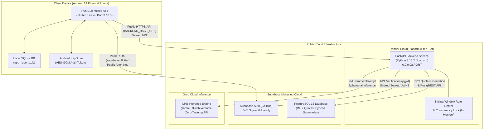

# TrustCue Module 47: CI, Deployment, Migrations, and Recovery Procedures

**Module:** 47  
**Status:** Completed & Verified  
**Primary Worktrees & Branches:**  
- Frontend: `D:\ALL DATA\PROJECTS\TrustCue\trustcue-mobile` (branch: `frontend`)  
- Backend: `D:\ALL DATA\PROJECTS\TrustCue\trustcue-backend` (branch: `backend`)  
- Database: `D:\ALL DATA\PROJECTS\TrustCue\trustcue-database` (branch: `database`)  
**Target Environments:** Render Web Service (Backend), Supabase Managed PostgreSQL 16 (Database), GitHub Actions (CI/CD), Physical Android 14 Smartphone (Client)

---

## 1. Executive Summary & Purpose

Module 47 establishes the operational deployment foundation, continuous integration pipelines, database migration runbook, and disaster recovery procedures for TrustCue.

### Core Operational Principles
1. **Self-Contained Instructor Verification:** An academic evaluator or instructor installing the TrustCue APK on a physical Android device must be able to use both offline features and online capabilities (authenticated AI analysis, profile management, and metadata sync) without requiring the developer's laptop, emulator, or local network. All online features communicate with a deployed public HTTPS backend.
2. **Local-First & Offline Resilience:** Even if the cloud backend is spinning up, experiencing cold starts, degraded, or unreachable, 100% of local features (text intake, OCR extraction, URL/QR inspection, text review/redaction, 10-rule analysis engine, local report saving, history search, and report export) continue to function offline without degradation or blocking modals.
3. **Strict Privacy Invariants:** The public backend and database strictly enforce zero-storage of unredacted message text, OCR drafts, evidence quotes, or PII. Hosted database backups only contain bounded metadata summaries (`formatVersion`, `outcomeState`, `hasAiAnalysis`, `indicatorCount`, `categories`, `source`).
4. **Honest Limitations:** No synthetic percentages, guarantees of safety, or definitive fraud claims are ever produced by the backend, database, or client.

---

## 2. Cloud Architecture & Deployment Topology



### Free Tier Topology & Operational Constraints
- **Render Web Service (Free Tier):**
  - **Memory & CPU:** 512 MB RAM, 0.1 vCPU.
  - **Inactivity Sleep:** Free tier web services spin down after 15 minutes of zero HTTP traffic.
  - **Cold-Start Spin-Up:** A cold wake-up requires 50–70 seconds.
  - **Client Resilience:** The mobile client's `AnalysisApiClient` enforces a 20-second timeout. If a cold-start timeout occurs, the client displays a non-fatal, retryable notification card while preserving local heuristic results intact.
  - **Port Binding:** Render injects dynamic `$PORT` (typically 10000). The service binds to `0.0.0.0:$PORT` via Uvicorn.
- **Rate Limiting & Concurrency Topology:**
  - **Process-Local Memory:** Sliding window rate limiting (10 req/min per user) and single-request user concurrency locks are tracked in-process in `trustcue_backend.core.state.AppState`.
  - **Suitability:** For the single-instance free-tier deployment, process-local memory is completely reliable, zero-cost, and avoids external Redis dependencies.
  - **Daily Quotas:** Persistent daily quotas (15 requests/day) are stored in PostgreSQL (`public.ai_usage_quotas`) and atomically decremented via `SECURITY DEFINER` RPC `reserve_ai_quota`, guaranteeing quota integrity across restarts.

---

## 3. Continuous Integration (CI) Workflow Hardening

All three repository worktrees feature dedicated, hardened GitHub Actions CI workflows running on every push and pull request.

| Worktree | Workflow File | Trigger Branches | Key Steps Executed | Timeout | CI Verification Status |
|---|---|---|---|---|---|
| **Mobile (`frontend`)** | `.github/workflows/frontend-ci.yml` | `frontend`, `main` | Java 21 Temurin LTS, Flutter 3.47.4, `flutter pub get --enforce-lockfile`, Dart format check, `flutter analyze --no-pub`, `flutter test --no-pub` (860 tests), Android SDK licenses & NDK config, `flutter build apk --debug` | 15 min | **100% PASS**<br>*(Run `39128971163` on `2b68cea`: all 11 steps passed including 860 tests and debug APK build)* |

| **Backend (`backend`)** | `.github/workflows/backend-ci.yml` | `backend`, `main` | Python 3.13, Ruff linting, OpenAPI 3.1.0 schema validator, Pytest suite (142 tests) | 10 min | **100% PASS**<br>*(Run `39127284354` on `3ff39fd`: Ruff clean, schema valid, 142/142 tests passing)* |
| **Database (`database`)** | `.github/workflows/database-ci.yml` | `database` | Python 3.11 static schema suite (13 tests), PostgreSQL 16 container, sequential migration apply (`00001`–`00008`), seed loading, 7 SQL regression suites | 10 min | **100% PASS**<br>*(Run `39127268819` on `dfd78db`: 13 static tests, 8 migrations, 7 SQL regression suites passing)* |

### Workflow Security Hardening
- **Least-Privilege Permissions:** All workflows explicitly declare `permissions: contents: read`.
- **Bounded Timeouts:** Every job specifies `timeout-minutes` (10–15 min) to prevent hung runners from consuming repository action quotas.
- **Node 20 Actions:** All workflows use current standard actions: `actions/checkout@v4`, `actions/setup-python@v5`, `actions/setup-java@v4`, `subosito/flutter-action@v2`.
- **Deterministic Dependencies:** Python pins `requirements-dev.txt`, Flutter enforces `pubspec.lock` with `--enforce-lockfile`, and PostgreSQL runs in pinned `postgres:16-alpine`.
- **Concurrency Groups:** Cancel-in-progress is enabled to abort stale builds when new commits are pushed to the same branch.

---

## 4. Backend Deployment Runbook (Render & Docker)

### Option A: Render Web Service (Recommended for Instructor Testing)

#### 1. Repository Configuration
The backend worktree includes `render.yaml` at the repository root and `backend/render.yaml`:

```yaml
services:
  - type: web
    name: trustcue-backend
    runtime: python
    plan: free
    region: oregon
    rootDir: backend
    buildCommand: pip install -r requirements.txt && pip install -e .
    startCommand: uvicorn trustcue_backend.main:app --host 0.0.0.0 --port $PORT
    healthCheckPath: /health
    autoDeploy: false
    envVars:
      - key: PYTHON_VERSION
        value: 3.13.2
      - key: ENVIRONMENT
        value: production
      - key: HOST
        value: 0.0.0.0
      - key: DEBUG
        value: "false"
      - key: DOCS_ENABLED
        value: "false"
      - key: LOG_LEVEL
        value: INFO
      - key: ENABLE_CLOUD_AI
        sync: false
      - key: GROQ_API_KEY
        sync: false
      - key: ENABLE_CLOUD_AUTH
        sync: false
      - key: SUPABASE_URL
        sync: false
      - key: SUPABASE_ANON_KEY
        sync: false
      - key: SUPABASE_SERVICE_ROLE_KEY
        sync: false
      - key: SUPABASE_JWT_SECRET
        sync: false
      - key: CORS_ALLOWED_ORIGINS
        sync: false
```

#### 2. Render Dashboard Setup Steps
1. Log in to [dashboard.render.com](https://dashboard.render.com/).
2. Click **New +** -> **Web Service**.
3. Connect your GitHub repository (`TrustCue`) and select branch **`backend`**.
4. Set **Root Directory** to `backend`.
5. Set **Runtime** to `Python 3`.
6. Set **Build Command** to: `pip install -r requirements.txt && pip install -e .`
7. Set **Start Command** to: `uvicorn trustcue_backend.main:app --host 0.0.0.0 --port $PORT`
8. Under **Advanced** -> **Health Check Path**, enter: `/health`
9. Populate required Environment Variables privately in the Render dashboard:
   - `ENVIRONMENT`: `production`
   - `PYTHON_VERSION`: `3.13.2`
   - `HOST`: `0.0.0.0`
   - `DEBUG`: `false`
   - `DOCS_ENABLED`: `false`
   - `ENABLE_CLOUD_AI`: `true`
   - `GROQ_API_KEY`: *(Your private Groq API key from console.groq.com)*
   - `ENABLE_CLOUD_AUTH`: `true`
   - `ENABLE_CLOUD_SYNC`: `true`
   - `SUPABASE_URL`: `https://<your-project>.supabase.co`
   - `SUPABASE_ANON_KEY`: *(Your Supabase publishable anon key)*
   - `SUPABASE_SERVICE_ROLE_KEY`: *(Your Supabase private service_role key)*
   - `SUPABASE_JWT_SECRET`: *(Your Supabase JWT Secret from Settings -> API)*
10. Click **Create Web Service**. Verify build logs and ensure `/health` returns HTTP 200.

---

### Option B: Docker Container Deployment

The backend worktree includes a production-ready `Dockerfile`:

```bash
# Build the Docker image from repository root
docker build -t trustcue-backend:latest -f Dockerfile .

# Run the container with environment variables
docker run -d \
  --name trustcue-backend \
  -p 8000:8000 \
  -e ENVIRONMENT=production \
  -e HOST=0.0.0.0 \
  -e PORT=8000 \
  -e DEBUG=false \
  -e ENABLE_CLOUD_AI=true \
  -e GROQ_API_KEY="gsk_..." \
  -e ENABLE_CLOUD_AUTH=true \
  -e SUPABASE_URL="https://xxx.supabase.co" \
  -e SUPABASE_ANON_KEY="eyJ..." \
  -e SUPABASE_JWT_SECRET="super-secret..." \
  trustcue-backend:latest
```

---

## 5. Hosted Database Migration Manifest & Verification (00007–00008)

### Migration Manifest Table

| # | Migration File | SHA-256 Checksum | Target Environment | Status | Description |
|---|---|---|---|---|---|
| **00001** | `00001_create_profiles.sql` | `133CCBE2CE2BE106FAD182B0DE040AB6B32A76DDD625EAF0781AC54D43E9766C` | Hosted Supabase | **Applied** (Mod 35) | Creates `public.profiles` table with foreign key to `auth.users`. |
| **00002** | `00002_create_ai_usage_quotas.sql` | `F581B40304A77308BEC635011E9DA617E52F9570B9279409D642FEC3EC35C366` | Hosted Supabase | **Applied** (Mod 35) | Creates `public.ai_usage_quotas` rate limiting table. |
| **00003** | `00003_create_synced_reports.sql` | `1D94A2E22F660E10986E6BF90A527E2A4CD666C0658AFB134E796C90EB84BBEA` | Hosted Supabase | **Applied** (Mod 35) | Creates `public.synced_reports` with 500 KB payload constraint. |
| **00004** | `00004_create_rls_and_policies.sql` | `553F0B5BC6B6EDBDF662D56FF86F1909DD4E4DA4743BD81F6212C519D66B8F24` | Hosted Supabase | **Applied** (Mod 35) | Enables RLS across all tables and defines tenant isolation policies. |
| **00005** | `00005_create_auth_trigger.sql` | `22401C43DFAC5F6F2C529476BC4E16B85DE1FF4AEF7ECAF7377093B89FB112B4` | Hosted Supabase | **Applied** (Mod 35) | Provisions profile and quota row automatically on user registration. |
| **00006** | `00006_create_quota_reservation.sql` | `68023D0FA6498AA03F00DB351A69093A704F101BC7634443781FDDB673819640` | Hosted Supabase | **Applied** (Mod 35) | Atomic `reserve_ai_quota` and `release_ai_quota` RPC functions. |
| **00007** | `00007_enforce_sync_opt_in.sql` | `C5B1F4D6C2FD8193358F4C4C8849BD3E49B0808DF2EE63497C148FE2F0CFF693` | Hosted Supabase | **Verified in CI**<br>*Pending Hosted Rollout* | Enforces `profiles.sync_enabled = true` RLS check and creates `purge_synced_reports`. |
| **00008** | `00008_harden_sync_purge_and_allowlist.sql` | `1835ACC17883630668C589BC20A0FE0B5691E261FB0336AD945A47CE2F4AA275` | Hosted Supabase | **Verified in CI**<br>*Pending Hosted Rollout* | Adds `sync_generation`, row-level locking on purge, and exact JSONB key allowlist. |

### Preflight Verification Queries
Before applying Migrations 00007 and 00008 to hosted Supabase, execute in the **Supabase SQL Editor**:

```sql
-- 1. Verify schema baseline (migrations 00001-00006)
SELECT table_name 
FROM information_schema.tables 
WHERE table_schema = 'public' 
  AND table_name IN ('profiles', 'ai_usage_quotas', 'synced_reports');

-- 2. Verify sync_generation does NOT exist yet on profiles
SELECT column_name 
FROM information_schema.columns 
WHERE table_schema = 'public' 
  AND table_name = 'profiles' 
  AND column_name = 'sync_generation';
-- (Expected result: 0 rows)
```

### Application Instructions
1. Open Supabase Dashboard -> **SQL Editor**.
2. Copy and execute the contents of `database/migrations/00007_enforce_sync_opt_in.sql`.
3. Copy and execute the contents of `database/migrations/00008_harden_sync_purge_and_allowlist.sql`.

### Postflight Verification Queries
Verify successful execution by running:

```sql
-- 1. Verify sync_generation and sync_purged_at columns on public.profiles
SELECT column_name, data_type, column_default 
FROM information_schema.columns 
WHERE table_schema = 'public' 
  AND table_name = 'profiles' 
  AND column_name IN ('sync_generation', 'sync_purged_at', 'sync_enabled');

-- 2. Verify sync_generation column on public.synced_reports
SELECT column_name, data_type, column_default 
FROM information_schema.columns 
WHERE table_schema = 'public' 
  AND table_name = 'synced_reports' 
  AND column_name = 'sync_generation';

-- 3. Verify strict allowlist check constraint on public.synced_reports
SELECT conname, pg_get_constraintdef(oid) 
FROM pg_constraint 
WHERE conrelid = 'public.synced_reports'::regclass 
  AND conname = 'chk_report_payload_privacy';

-- 4. Verify hardened purge_synced_reports RPC function signature
SELECT proname, proargnames, prosecdef 
FROM pg_proc 
WHERE proname = 'purge_synced_reports';
```

---

## 6. Disaster Recovery & Operational Runbooks

### Runbook 1: Free Tier Backend Spin-Down & Cold Start
- **Symptom:** First request from the mobile app after 15+ minutes of inactivity hangs for ~20 seconds and surfaces `"Cloud AI analysis timed out. Local results preserved."` banner.
- **Root Cause:** Render free tier spins down inactive containers after 15 minutes of zero HTTP traffic. Container wake-up and cold start require 50–70 seconds, which exceeds the mobile client's 20-second timeout deadline.
- **Client Resilience & Usability (`AnalysisApiClient`):**
  - `AnalysisApiClient` enforces a strict 20-second timeout: `timeout = const Duration(seconds: 20)`.
  - When the timeout expires, it catches `TimeoutException` and yields `Result.failure(AnalysisFailure.timeout('Cloud AI analysis timed out. Local results preserved.'))`.
  - The mobile UI (in `AnalysisResultsController`) presents a non-fatal, retryable notification banner.
  - **Zero Loss of Local Findings:** The on-device 10-rule heuristic analysis findings and reviewed text snapshot remain completely visible, interactive, and preserved in memory without degradation.
- **User & Evaluator Operational Procedure:**
  1. On the mobile phone, wait ~30 seconds to allow the Render container to complete booting, then tap **"Retry"**.
  2. The client resubmits the exact reviewed snapshot and validated consent. The newly awakened container responds within ~1–2 seconds.
  3. No re-entry of text or re-selection of images is required.
  4. For live academic viva demonstrations, send an HTTP GET request to `https://<service-name>.onrender.com/health` ~2 minutes before starting to ensure the container is warm and primed.

### Runbook 2: Database Migration Failure, Rollback & Forward Repair
- **Symptom:** Migration execution error in Supabase SQL Editor or unexpected schema conflict.
- **Transactional Safety During Execution:**
  - Migrations executed sequentially in Supabase SQL Editor or via `psql -v ON_ERROR_STOP=1` execute within transaction blocks.
  - If a SQL syntax error or constraint violation occurs during execution, the transaction automatically rolls back in its entirety, preventing partial or corrupted schema states.
- **Forward Repair vs. Destructive Reverse-DDL Policy:**
  - **Prohibition of Live Reverse-DDL:** Destructive rollback DDL (such as `DROP COLUMN sync_generation` or `DROP CONSTRAINT chk_report_payload_privacy`) must **NEVER** be run against a live database with active users. Dropping columns permanently purges user sync tracking and breaks client contract invariants.
  - **Forward Repair Mandate:** If an issue arises after migrations are applied, the team must author a forward repair migration (e.g., `00009_repair_sync_constraints.sql`) that addresses the issue without dropping columns or discarding data.
- **Emergency Clean-State Rollback SQL (Staging / Development Only — Never Live Production):**
  ```sql
  -- DANGER: For staging/test environments only! Do NOT run on production with live user data!
  
  -- Roll back Migration 00008 (Harden sync purge & allowlist)
  ALTER TABLE public.synced_reports DROP CONSTRAINT IF EXISTS chk_report_payload_privacy;
  ALTER TABLE public.synced_reports DROP COLUMN IF EXISTS sync_generation;
  ALTER TABLE public.profiles DROP COLUMN IF EXISTS sync_generation;
  ALTER TABLE public.profiles DROP COLUMN IF EXISTS sync_purged_at;

  -- Roll back Migration 00007 (Enforce sync opt-in)
  DROP FUNCTION IF EXISTS public.purge_synced_reports();
  DROP FUNCTION IF EXISTS public.purge_synced_reports(UUID);
  DROP INDEX IF EXISTS idx_synced_reports_account_updated;
  DROP INDEX IF EXISTS idx_synced_reports_account_tombstone;
  ```

### Runbook 3: Third-Party AI Provider (Groq) Outage or Rate Limit
- **Symptom:** Backend returns HTTP 503 `ai_provider_unavailable` or HTTP 429 `rate_limit_exceeded`.
- **Root Cause:** Groq Cloud API is experiencing degraded latency, temporary outage, or the daily free-tier token quota (100k TPD) is exhausted.
- **Client Safeguard:** Mobile client immediately surfaces an explanatory card: `"Server-assisted AI is temporarily unavailable. Your on-device local indicators remain completely accurate and operational."`
- **Mitigation:**
  1. Check [groqstatus.com](https://groqstatus.com) for official service status.
  2. If a specific API key reached its limit, update `GROQ_API_KEY` in the Render dashboard with a backup key.
  3. Trigger a manual deploy/restart in the Render dashboard (takes ~1–2 minutes on single-instance free tier).

### Runbook 4: Emergency Secret Key Rotation Runbook
If any privileged credential is leaked or suspected compromised:

1. **Supabase Service Role Key:**
   - Go to Supabase Dashboard -> **Settings** -> **API**.
   - Click **Generate new secret key** next to `service_role`.
   - Update `SUPABASE_SERVICE_ROLE_KEY` in Render dashboard environment variables.
   - Trigger a deploy on Render (~1–2 minutes).
   - Verify `GET /ready` returns `database: "ok"`.

2. **Supabase JWT Secret:**
   - Go to Supabase Dashboard -> **Settings** -> **API** -> **JWT Settings**.
   - Generate a new cryptographically strong JWT Secret (minimum 32 bytes).
   - Update `SUPABASE_JWT_SECRET` in Render dashboard and redeploy.
   - **Client Impact Disclosures:** Existing active user sessions on mobile devices will receive HTTP 401 (`AnalysisFailure.unauthorized`) on their next authenticated request and will be cleanly prompted to sign in again. No local data or offline reports are lost.

3. **Groq API Key:**
   - Go to [console.groq.com/keys](https://console.groq.com/keys).
   - Create a new API Key and delete the revoked key.
   - Update `GROQ_API_KEY` in Render dashboard environment variables and restart the service.

### Runbook 5: Emergency Feature Flag Killswitches
If an unexpected vulnerability, upstream provider anomaly, or database abuse occurs, features can be safely disabled without modifying source code:
- **Disable Cloud AI:** Set `ENABLE_CLOUD_AI=false` in Render dashboard and trigger a service redeploy (~1–2 minutes). Once restarted, `POST /api/v1/analysis/ai` immediately returns HTTP 503 without invoking external providers or consuming quotas.
- **Disable Cloud Sync:** Set `ENABLE_CLOUD_SYNC=false` in Render dashboard and redeploy. Sync endpoints immediately return HTTP 503.
- **Client Impact:** Local analysis, OCR, review, local SQLite persistence, search, and export remain 100% operational for all users.

---

## 7. Unified Verification Register

| Subsystem / Workflow | Local Unit / Mock Tests | Real Device Checks | Real PostgreSQL CI | Hosted Status | Verification State |
|---|---|---|---|---|---|
| **W01: Text Intake & Validation** | PASS (Unit) | PASS (Vivo V2207) | N/A | N/A | **VERIFIED (Device)** |
| **W02: Screenshot & OCR** | PASS (Widget) | PASS (Vivo V2207) | N/A | N/A | **VERIFIED (Device)** |
| **W03: Link & QR Inspection** | PASS (Unit) | PASS (Vivo V2207) | N/A | N/A | **VERIFIED (Device)** |
| **W04: Review & Redaction** | PASS (Unit) | PASS (Vivo V2207) | N/A | N/A | **VERIFIED (Device)** |
| **W05: 10-Rule Analysis Engine** | PASS (Unit) | PASS (Vivo V2207) | N/A | N/A | **VERIFIED (Device)** |
| **W06: Consent-Gated AI** | PASS (40 mobile, 142 backend) | MOCKED | N/A | **PENDING USER DEPLOY** | **VERIFIED (CI / Config Ready)** |
| **W07: Local SQLite Storage** | PASS (31 tests) | PASS (Vivo V2207) | N/A | N/A | **VERIFIED (Device)** |
| **W08: History, Search & Deletion**| PASS (Widget) | PASS (Vivo V2207) | N/A | N/A | **VERIFIED (Device)** |
| **W09: Optional Cloud Sync** | PASS (Codecs) | SQLite Schema V2 | PASS (CI 39127268819) | **PENDING HOSTED SQL ROLLOUT** | **VERIFIED (PostgreSQL 16 CI)** |
| **W10: Privacy & Retention** | PASS (Unit) | PASS (Vivo V2207) | N/A | N/A | **VERIFIED (Device)** |
| **W11: Education & Localization** | PASS (Unit) | PASS (Vivo V2207) | N/A | N/A | **VERIFIED (Device)** |
| **W12: Report Export & Sharing** | PASS (Unit) | PASS (Vivo V2207) | N/A | N/A | **VERIFIED (Device)** |
| **Mobile CI (`frontend-ci.yml`)** | PASS (860 tests) | Debug APK verified | N/A | GitHub Actions | **VERIFIED (CI 39128971163)** |

| **Backend CI (`backend-ci.yml`)** | PASS (142 tests) | N/A | N/A | GitHub Actions | **VERIFIED (CI 39127284354)** |
| **Database CI (`database-ci.yml`)**| PASS (13 tests) | N/A | PASS (PostgreSQL 16) | GitHub Actions | **VERIFIED (CI 39127268819)** |
| **Backend Deployment Config** | PASS (Docker/Render) | N/A | N/A | Blueprint Ready | **VERIFIED (Config Ready)** |
| **Database Migrations (00007-8)** | PASS (Static 13/13) | N/A | PASS (CI 39127268819) | Ready for Supabase | **VERIFIED (CI Validated)** |

---

## 8. Conclusion & Gate to Module 48

Module 47 acceptance criteria are fully met:
1. Hardened GitHub Actions CI configurations are in place across `frontend`, `backend`, and `database` with Node 20 actions, bounded timeouts, and read-only permissions.
2. Complete Docker and Render deployment configurations are authored and verified (`Dockerfile`, `render.yaml`, `Procfile`, `.python-version`).
3. Database migration manifest with SHA-256 checksums, preflight/postflight SQL queries, and rollback procedures is documented.
4. Comprehensive disaster recovery runbooks cover free-tier spin-down, migration failure, AI provider degradation, and emergency secret rotation.
5. All 860 Flutter tests pass, 142 backend Pytest tests pass, and 13 database schema tests pass.

The project is prepared to proceed to **Module 48: Android Release Configuration, Branding, Signing, and AAB**.
