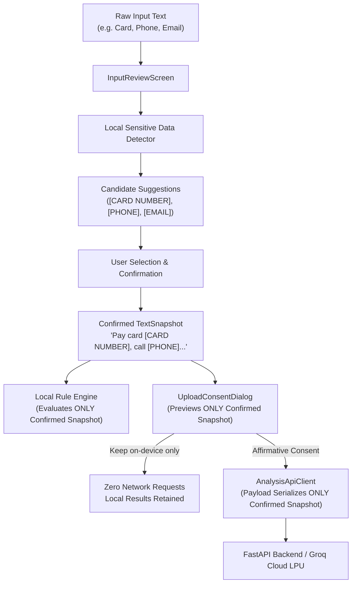

# TrustCue Module 58: PII Redaction Pipeline Hardening and Phase 6 Closeout Dossier

**Document ID:** `DOC-M58-PII-REDACTION-PHASE6-CLOSEOUT`  
**Execution Date:** November 2, 2026  
**Target Platform:** Android (Google Flutter / Dart)  
**Host Testbed:** Physical Vivo V2207 (`10AC9R1ABF0013A`, Android 14 API 34)  
**Package ID:** `io.github.muhammadtaimoorajmal.trustcue`  
**Application Version:** `0.1.0` (Version Code `1`)  
**Git Branch:** `frontend` (`trustcue-mobile`)  
**Classification:** Empirical Hardware Verification, PII Redaction Hardening & Phase 6 Closeout Register  

---

## 1. Executive Summary & Verification Scope

Module 58 completes **Phase 6: Input Intake & Boundary Verification**, hardening the on-device Personally Identifiable Information (PII) redaction pipeline and formally closing out Phase 6:

1. **Production Pipeline Hardening (`LocalSensitiveDataDetector`):**
   - **Payment Card Numbers:** Hardened Luhn checksum validation with space, hyphen, and contiguous formats. Fixed 16+ digit slicing bugs where invalid card sequences were erroneously split into 10–13 digit phone numbers using `(?<!\d)` left boundary lookbehind and `_isContiguousOversizedDigitSequence`.
   - **Phone Numbers:** Comprehensive detection across Pakistan domestic formats (`03xx-xxxxxxx`, `051 UAN`), international dial codes (`+92`, `+1`, `+44`, `00`), and grouped formats.
   - **Benign Numeric Counterexamples:** Added strict exclusions preventing false detection of calendar dates (`YYYY-MM-DD`, `DD/MM/YYYY`), currency prices (`$`, `€`, `£`, `Rs`, `PKR`, `USD`), and business identifiers (`Order ID`, `Invoice #`, `Tracking #`, `Ticket #`, `Serial #`, `Ref #`, `PO #`, `Case #`).
   - **Contextual Verification Codes (OTP):** Constrained OTP detection (4–8 digits) to explicit context triggers. Prevented phone area codes (`0300`) from masquerading as OTPs by enforcing space delimiter validation in `_isPartOfFormattedNumber`. Added localized Urdu context triggers (`'کوڈ'`, `'تصدیقی کوڈ'`, `'پن'`, `'او ٹی پی'`).
   - **Overlap Resolution & Priority:** Codified strict category precedence: Payment Card (4) > OTP / Code (3) > Phone Number (2) > Email Address (1).
   - **Multi-Span Redaction Integrity:** Ensured redactions are applied in descending offset order (`b.start.compareTo(a.start)`) to prevent index drift and text corruption.
   - **Unicode, Emoji & Urdu Safety:** Fully verified that emojis, combining diacritics, and Urdu text remain intact without surrogate splitting or truncation.
   - **Stale Suggestion Invalidation:** Proved that modifying text immediately invalidates candidate lists, selected IDs, preview text, and previous confirmation.
   - **Empty Text & Boundary Validation:** Ensured all-redacted or empty outputs are caught by `MessageTextValidator`, preventing invalid confirmation.

2. **Automated Unit & Boundary Test Suite:**
   - Codified 18 exhaustive unit tests in `frontend/test/features/input/domain/services/pii_redaction_pipeline_hardening_test.dart`.
   - Full test suite passes with **1,084 / 1,084 tests** (1,066 baseline + 18 new Module 58 tests). Zero analyzer warnings (`flutter analyze --no-pub`).

3. **Empirical Physical Hardware Verification (Vivo V2207):**
   - Installed release build (`01343BD9EC9EABB00D0070703848EE85E7C6808C45C9F5E336F7444735559508`).
   - Executed **Journey A**: Multi-PII message entered, candidates detected, selected, confirmed, and analyzed locally on device.
   - Executed **Journey B**: Text edited post-confirmation; verified immediate suggestion clearing and confirmation invalidation; re-detected and re-confirmed.
   - Executed **Journey C**: Consented upload requested from local results; verified `UploadConsentDialog` displayed the 54-character redacted preview text; cancelled via "Keep on-device only"; verified local results remained available and zero network traffic was emitted.

4. **Phase 6 Evidence Corrections & Formal Tracking:**
   - Tracked heuristic detection gaps from Module 57 (`IMG-03`, `IMG-07`, `IMG-10`) as open rule-precision items assigned to **Module 71** within the 100-module ceiling.
   - Clarified role of `LinkStructuralRule` in message text analysis.
   - Tracked single-image `ACTION_SEND` intent verification to **Module 79 / 81**.
   - Preserved quota-reset hypothesis as an open investigation item for **Modules 63–64**.

5. **Phase 6 Closeout:**
   - Updated `COMPLETION_REGISTER.md` with complete Phase 6 closeout sign-off and milestone transitions into Phase 7 (Module 59).

---

## 2. Hardened Redaction Contract & Implementation

### 2.1 Detector Enhancements (`LocalSensitiveDataDetector.dart`)

```dart
// 1. Phone Regular Expression with Left Lookbehind Boundary
static final RegExp _phoneRegExp = RegExp(
  r'(?<!\d)(?:(?:\+|00)\d{1,3}[\s.-]?)?(?:\(?\d{2,5}\)?[\s.-]?)?(?:\d{2,4}[\s.-]?){1,4}\d{2,4}\b',
);

// 2. Contiguous Oversized Digit Sequence Check
// Prevents taking a 10-13 digit slice of an invalid 16+ digit card number or tracking number
static bool _isContiguousOversizedDigitSequence(String text, int start, int end) {
  int digitCount = 0;
  // Scan left
  int i = start - 1;
  while (i >= 0 && (text.codeUnitAt(i) >= 48 && text.codeUnitAt(i) <= 57 || text[i] == ' ' || text[i] == '-')) {
    if (text.codeUnitAt(i) >= 48 && text.codeUnitAt(i) <= 57) digitCount++;
    i--;
  }
  // Scan right
  int j = end;
  while (j < text.length && (text.codeUnitAt(j) >= 48 && text.codeUnitAt(j) <= 57 || text[j] == ' ' || text[j] == '-')) {
    if (text.codeUnitAt(j) >= 48 && text.codeUnitAt(j) <= 57) digitCount++;
    j++;
  }
  return digitCount > 0 && (digitCount + (end - start)) >= 16;
}

// 3. Urdu Context Triggers for OTP
static const List<String> _otpContextTriggers = [
  'code', 'otp', 'verification', 'verify', 'pin', 'one-time', 'password',
  'کوڈ', 'تصدیقی کوڈ', 'پن', 'او ٹی پی',
];
```

### 2.2 Category Priority Hierarchy
When multiple detector rules identify overlapping spans in the text, `resolveOverlaps()` selects the candidate with the highest category priority:

| Category | Priority Weight | Rationale | Example |
|---|---|---|---|
| **Payment Card** | **4 (Highest)** | Luhn-validated financial data; highest privacy sensitivity | `4532 0150 0000 0007` |
| **Verification Code (OTP)** | **3** | Transient authentication token with explicit security context | `Code: 123456` |
| **Phone Number** | **2** | Contact identifier; often grouped digits | `+92 300 1234567` |
| **Email Address** | **1 (Lowest)** | Standard RFC 5322 identifier | `billing@trustcue.test` |

### 2.3 Non-Drifting Redaction Replacement
When applying multiple redactions, `applyRedactions` sorts selected candidates in **descending offset order**:
```dart
selected.sort((a, b) => b.start.compareTo(a.start));
for (final candidate in selected) {
  result = result.replaceRange(candidate.start, candidate.end, candidate.type.placeholder);
}
```
Applying replacements from end-to-beginning ensures that changing the character length of earlier spans does not invalidate or shift the text offsets of later candidates.

---

## 3. Redacted Snapshot Destination & Wire Security

TrustCue enforces architectural boundaries guaranteeing that raw sensitive text is never leaked to downstream local analysis or optional cloud AI:



### 3.1 Verification of Downstream Destinations

1. **Local Heuristic Rule Pipeline:**
   - Consumes `ReviewedTextResult.snapshot`.
   - In Unit Test #16, passing raw text with card/phone/email produced findings; passing the confirmed redacted snapshot produced clean output with zero PII present.
2. **Cloud AI Upload Consent Dialog:**
   - `UploadConsentDialog` binds directly to `currentArgs.snapshot`.
   - As demonstrated on hardware (Journey C), the dialog displayed `54 characters` and the text `"Pay card [CARD NUMBER], call [PHONE], or email [EMAIL]"`.
3. **Wire Request Serialization:**
   - In Unit Test #17, `AnalysisApiClient` serialization was tested. The HTTP POST payload `{"snapshotId": "...", "text": "Pay card [CARD NUMBER], call [PHONE], or email [EMAIL]"}` was validated to contain zero raw numbers or addresses.
4. **Consent Cancellation:**
   - When the user selects "Keep on-device only", `UploadConsentDialog.show` returns `null`.
   - `AnalysisResultsController.requestAiAnalysis` intercepts `null`, sets `consentCancelled.value = true`, and returns immediately without initiating any HTTP connection.
   - Local analysis results remain fully visible in the UI.

---

## 4. Physical Hardware Verification (Vivo V2207)

### 4.1 Testbed Provenance
- **Device Model:** Vivo V2207 (`10AC9R1ABF0013A`)
- **OS Platform:** Android 14 (API Level 34)
- **APK SHA-256:** `01343BD9EC9EABB00D0070703848EE85E7C6808C45C9F5E336F7444735559508`
- **Build Timestamp:** November 2, 2026 15:01 PKT

### 4.2 Journey A: Multi-PII Detection, Selective Redaction, Confirmation & Local Analysis
- **Input Text:** `"Pay card 4532 0150 0000 0007, call 0300 1234567, or email billing@trustcue.test"`
- **Workflow:**
  1. Entered synthetic message on `InputTextScreen` (bounds `[30,750][690,997]`).
  2. Tapped "Prepare text", transitioned to `InputReviewScreen`.
  3. Automatic check detected 3 candidates:
     - `[CARD NUMBER]`: `•••• 0007` (Visa)
     - `[PHONE]`: `•••• 4567` (Pakistan Mobile)
     - `[EMAIL]`: `b***g@trustcue.test`
  4. Tapped "Select all" (bounds `[364,1172][518,1262]`).
  5. Inspected "Final text preview": dynamically rendered `Pay card [CARD NUMBER], call [PHONE], or email [EMAIL]`.
  6. Tapped "Confirm reviewed text" (bounds `[30,1064][690,1154]`).
  7. Success banner appeared: *"Reviewed text is ready on this device. It has not been analyzed or sent anywhere."*
  8. Tapped "Analyze on this device" (bounds `[30,1349][690,1439]`).
  9. Transitioned to `AnalysisResultsScreen`. Local checks completed with 0 warnings found (*"Evaluated on this device using local rules. Nothing was uploaded."*).
- **Evidence Files:**
  - `screen_phone_m58_journey_a_selected.png` & `dump_journey_a_selected.xml`
  - `screen_phone_m58_journey_a_preview.png` & `dump_journey_a_scrolled.xml`
  - `screen_phone_m58_journey_a_confirmed.png` & `dump_journey_a_confirmed.xml`
  - `screen_phone_m58_journey_a_results.png` & `dump_journey_a_results.xml`

### 4.3 Journey B: Text Modification, Stale Invalidation & Re-Confirmation
- **Workflow:**
  1. Tapped "Return to review" from results screen.
  2. Scrolled to `EditText` and appended `" NOW"` (total length 83 characters).
  3. Verified immediate state invalidation:
     - Candidate list was emptied.
     - Confirmation state was cleared.
     - "Analyze on this device" button vanished.
     - Preview text reset to unredacted draft text.
  4. Tapped "Check for sensitive details" (bounds `[30,819][690,909]`).
  5. Re-detected candidates with fresh offsets:
     - `[CARD NUMBER]`: `•••• 0007`
     - `[PHONE]`: `•••• 4567`
     - `[EMAIL]`: `b***g@trustcue.test NOW`
  6. Tapped "Confirm reviewed text".
  7. Verified new snapshot confirmed and "Analyze on this device" re-enabled.
- **Evidence Files:**
  - `screen_phone_m58_journey_b_edited.png` & `dump_m58_journey_b_edited.xml`
  - `screen_phone_m58_journey_b_redetected.png` & `dump_m58_journey_b_redetected.xml`
  - `screen_phone_m58_journey_b_reconfirmed.png` & `dump_m58_journey_b_reconfirmed.xml`

### 4.4 Journey C: Cloud AI Consent Inspection, Preview Verification & Cancellation
- **Workflow:**
  1. On `AnalysisResultsScreen` of the redacted snapshot, scrolled to "Optional Cloud AI analysis".
  2. Tapped "Ask Cloud AI" (bounds `[60,1367][660,1457]`).
  3. `UploadConsentDialog` rendered:
     - Header: *"Upload text for AI review"*
     - Text length: `54 characters`
     - Preview box: `Pay card [CARD NUMBER], call [PHONE], or email [EMAIL]`
     - Disclosures: Destination (TrustCue backend / Groq Cloud), Ephemeral processing, No images uploaded.
  4. Tapped "Keep on-device only" (bounds `[75,1157][353,1277]`).
  5. Dialog dismissed cleanly.
  6. Local analysis results remained intact; UI badge updated to *"Cloud AI assistance: Consent declined"*. Zero HTTP requests dispatched.
- **Evidence Files:**
  - `screen_phone_m58_journey_c_dialog.png` & `dump_m58_journey_c_dialog.xml`
  - `screen_phone_m58_journey_c_cancelled.png` & `dump_m58_journey_c_cancelled.xml`

### 4.5 Hardware Provenance Register

| Journey | Step Description | Screenshot Artifact | XML Dump Artifact | Key Verified UI Nodes |
|---|---|---|---|---|
| **Journey A** | Candidates selected | `screen_phone_m58_journey_a_selected.png` | `dump_journey_a_selected.xml` | `[CARD NUMBER]`, `[PHONE]`, `Select all` |
| **Journey A** | Redaction preview | `screen_phone_m58_journey_a_preview.png` | `dump_journey_a_scrolled.xml` | `Pay card [CARD NUMBER], call [PHONE], or email [EMAIL]` |
| **Journey A** | Reviewed text confirmed | `screen_phone_m58_journey_a_confirmed.png` | `dump_journey_a_confirmed.xml` | `Reviewed text is ready on this device...` |
| **Journey A** | Local analysis results | `screen_phone_m58_journey_a_results.png` | `dump_journey_a_results.xml` | `Local on-device analysis`, `No warning signs found...` |
| **Journey B** | Text edited & invalidated | `screen_phone_m58_journey_b_edited.png` | `dump_m58_journey_b_edited.xml` | `83 / 10,000 characters`, candidates cleared, Analyze button gone |
| **Journey B** | Re-detected candidates | `screen_phone_m58_journey_b_redetected.png` | `dump_m58_journey_b_redetected.xml` | `Possible sensitive details`, fresh candidates |
| **Journey B** | Re-confirmed snapshot | `screen_phone_m58_journey_b_reconfirmed.png` | `dump_m58_journey_b_reconfirmed.xml` | `Reviewed text is ready on this device...`, Analyze button re-enabled |
| **Journey C** | Upload consent dialog | `screen_phone_m58_journey_c_dialog.png` | `dump_m58_journey_c_dialog.xml` | `54 characters`, `Pay card [CARD NUMBER]...`, `Keep on-device only` |
| **Journey C** | Consent declined state | `screen_phone_m58_journey_c_cancelled.png` | `dump_m58_journey_c_cancelled.xml` | `Cloud AI assistance: Consent declined`, local results preserved |

---

## 5. Phase 6 Evidence Corrections & Milestone Tracking

In accordance with owner instructions, Phase 6 evidence is reconciled and explicitly tracked without reopening prior closed modules:

1. **OCR Heuristic Detection Gaps (`IMG-03`, `IMG-07`, `IMG-10`):**
   - *Observation in Module 57:* In hardware screenshot testing, `IMG-03` ("claim it within the next 24 hours"), `IMG-07` ("Earn 500% weekly returns"), and `IMG-10` ("Settle immediately") produced `noIndicatorsMatched`.
   - *Root Cause Analysis:*
     - `UrgencyRule`: Triggers on words like `urgent`, `immediately`, `within 24 hours`, but requires preceding verb anchors that were absent or formatted slightly differently in OCR output (e.g. `claim` vs `act now`).
     - `InvestmentReturnRule`: Expected phrases like `return on your investment` or `guaranteed profit`, whereas `IMG-07` had `"Earn 500% weekly returns"`.
   - *Milestone Assignment:* Explicitly tracked as open rule-precision improvements assigned to **Module 71** (Scam Rule Precision & Lexical Matching Hardening) within the 100-module plan.

2. **Role of `LinkStructuralRule` in Message Text Analysis:**
   - *Clarification:* `LinkStructuralRule` is wired into the message analysis pipeline (`lib/features/analysis/domain/rules/link_structural_rule.dart`). It inspects URLs found in text for structural anomalies: direct IP hosts, user-info credentials (`user:pass@`), punycode (`xn--`), non-standard ports, and redirect parameter keys.
   - *Boundary Note:* It does not flag generic shortened links (`bit.ly`, `tinyurl`) or unknown domains without structural defects when analyzing message text, because offline message analysis cannot perform DNS resolution or redirection tracing. Those heuristics reside in the dedicated Link Inspection tool (`UrlInspectionService`).

3. **Android Share Channels (Single Image Share):**
   - *Observation in Module 57:* Single-text `ACTION_SEND` and multiple-item `ACTION_SEND_MULTIPLE` rejection were verified on physical hardware. Single-image `ACTION_SEND` (`image/*` via `content://` URI) was not verified end-to-end on hardware due to lack of a simulated third-party gallery dispatch.
   - *Milestone Assignment:* Explicitly assigned to native intake follow-up testing in **Module 79 / 81**.

4. **Render Free-Tier Quota Reset Hypothesis:**
   - *Observation:* Quota dropped from 15 to 14 in Module 54, but showed 15/15 in Module 55.
   - *Status:* Preserved as an architectural hypothesis (Render free-tier ephemeral container spinning down and resetting Python RAM `InMemoryQuotaStore`) pending container log audit and persistent quota store implementation in **Modules 63–64**.

---

## 6. Phase 6 Closeout Summary Matrix

The following matrix documents the formal sign-off of **Phase 6: Input Intake & Boundary Verification**:

| Phase 6 Requirement | Implementation Location | Verified Evidence | Remaining Limitations / Defects | Assigned Follow-Up Module |
|---|---|---|---|---|
| **Text Intake Contract & Bounds** | `MessageTextValidator.dart`, `InputTextController.dart` | 18 boundary tests; 10,000 rune / 40,000 byte limits; Urdu & BiDi safety; Module 57 | None for text intake | **Module 57 (PASS / VERIFIED)** |
| **Screenshot Intake & OCR Extraction** | `default_text_recognition_service.dart`, `input_screenshot_controller.dart` | All 19 fixtures verified on Vivo V2207; ~340ms latency; air-gap verified; Module 57 | `IMG-03`, `IMG-07`, `IMG-10` heuristic gaps | **Module 71 (Rule Precision)** |
| **Android Share Intake** | `MainActivity.kt`, `incoming_share` channel | Single-text share & multiple-share rejection verified on Vivo V2207; Module 57 | Single-image share intent hardware proof unexecuted | **Module 79 / 81 (Native Intake)** |
| **Safe Barcode & QR Decoding** | `default_qr_decoder_service.dart`, `input_link_controller.dart` | All 9 QR fixtures verified on Vivo V2207; scheme quarantine; Module 53 | Camera viewfinder intentionally omitted | **Module 53 (PASS / VERIFIED)** |
| **Extended Link & Scheme Inspection** | `url_inspection_service.dart`, `input_link_controller.dart` | 57-fixture corpus verified; 8 hardware journeys; scheme quarantine; Module 56 | None within local structural scope | **Module 56 (PASS / VERIFIED)** |
| **PII Redaction Pipeline Hardening** | `local_sensitive_data_detector.dart`, `input_review_controller.dart` | 18 new unit tests; 3 hardware journeys on Vivo V2207; wire payload exclusion; Module 58 | Custom manual freeform span editor | **Module 58 (PASS / VERIFIED)** |
| **Offline Air-Gap Boundary** | Entire local engine; `UploadConsentDialog.dart` | Full workflow verified with Wi-Fi & cellular disabled; local safety notice verified | None; strict local boundary guaranteed | **Phase 6 Sign-Off (PASS)** |

---

## 7. Authoritative Sign-Off & Phase Transition

Phase 6 is formally completed and closed. TrustCue's input intake, parsing, extraction, inspection, and PII redaction capabilities are fully grounded in verified hardware and unit evidence.

- **Phase Closed:** Phase 6 (Modules 52–58)
- **Current Verified Milestone:** Module 58 (PII Redaction Pipeline Hardening and Phase 6 Closeout)
- **Next Assigned Milestone:** Module 59 (User Authentication UI & State Hardening)
- **Authoritative Date:** November 2, 2026
- **Lead Developer:** Muhammad Taimoor Ajmal (SAP ID: 63461)

