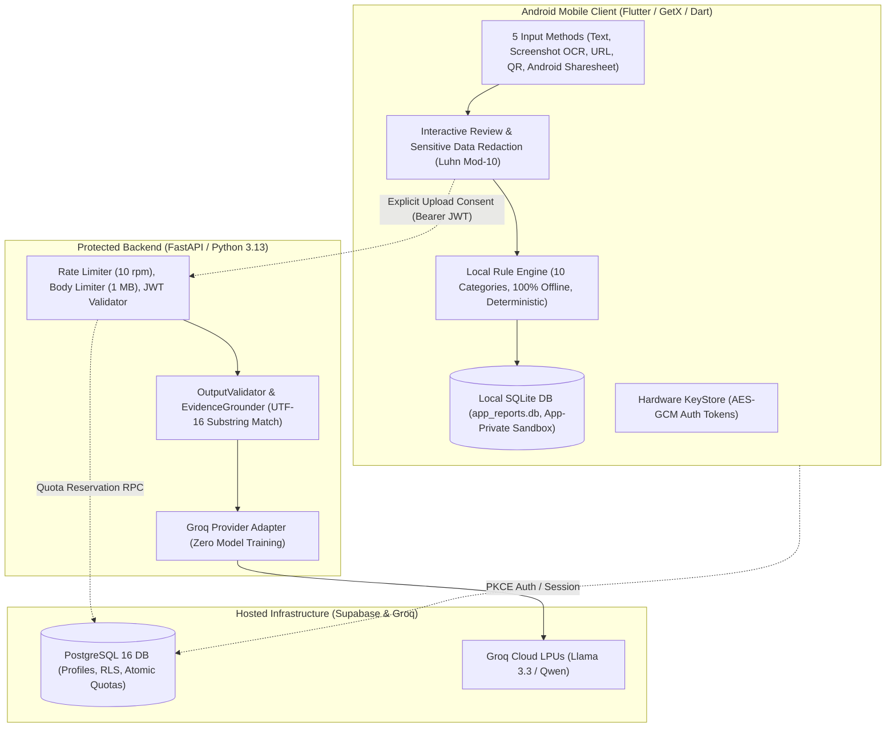

# TrustCue Viva Quick Revision Guide (Last-Minute Review)
**Mobile Application Development (CS3643) — BSCS Semester 5-1, Fall 2026**
**Riphah International University**

- **Student:** Muhammad Taimoor Ajmal (SAP ID: 63461)
- **Instructor:** Mr. Muhammad Shariq Hasnain
- **Project:** TrustCue — Scam-Indicator Awareness & Risk Explanation Assistant
- **Purpose:** 10-Minute High-Yield Cheat Sheet to review immediately before your viva.

---

## 1. 30-Second Elevator Pitch
> *"TrustCue is an Android mobile assistant designed to help users evaluate suspicious messages, screenshots, and links before falling victim to fraud. It uses a local-first architecture: completely offline on-device rules instantly highlight warning indicators like urgency or credential requests without sending data anywhere. If the user desires deeper contextual analysis, they can give explicit consent to run protected server-assisted AI, which strictly verifies every claim against the actual text. It never guarantees safety or invents fake risk percentages; it provides factual explanations and safe next steps."*

---

## 2. One High-Level Architecture Diagram

---

## 3. Technology Stack & Responsibility Cheat Sheet

| Component | Technology | Where It Runs | Core Responsibility |
|---|---|---|---|
| **Mobile UI & State** | Flutter (3.24) & GetX (4.7.3) | Device | Responsive UI, reactive state (`.obs`/`Obx`), controller lifecycle. |
| **Local OCR** | Google ML Kit Latin OCR | Device (Offline) | Extracts text from screenshots (Latin alphabet only). |
| **Local Rule Engine** | Pure Dart Heuristic Rules | Device (Offline) | Evaluates 10 indicator categories with clause negation logic. |
| **Local Persistence** | SQLite (`sqflite: 2.4.4+2`) | Device (Sandbox) | Offline reports, paginated history, sanitized debounced search. |
| **Session Security** | `flutter_secure_storage` | Device KeyStore | Hardware-backed AES-GCM encrypted refresh tokens. |
| **Backend API** | FastAPI & Python 3.13 | Server | REST routes, JWT verification, rate limiting, request validation. |
| **Data Validation** | Pydantic v2 (`extra="forbid"`) | Server | Strict schema parsing, preventing unexpected attributes. |
| **Evidence Grounding** | Python Substring Engine | Server | Validates that AI quotations exist verbatim in the user's text. |
| **Cloud Database** | PostgreSQL 16 (Supabase) | Hosted Cloud | `profiles`, `ai_usage_quotas`, `synced_reports`, kernel RLS policies. |
| **Cloud AI Inference**| Groq Cloud API | External Cloud | Fast LPU inference (`llama-3.3-70b-versatile` / `qwen/qwen3.8-27b`). |

---

## 4. Main Workflows at a Glance

### Workflow 1: Local Analysis (100% Offline & Private)
`Input (Text / OCR / URL / QR / Share)`
  $\rightarrow$ `Review & Heuristic Redaction (Phone, Email, Cards via Luhn)`
  $\rightarrow$ `Local Rule Engine (10 Categories, High/Med/Low sorting)`
  $\rightarrow$ `Evidence Trail (Exact UTF-16 Substring Highlights)`
  $\rightarrow$ `Save on Device (SQLite app_reports.db)`
  $\rightarrow$ `History & Search`

### Workflow 2: Server-Assisted AI (Consent-Gated & Grounded)
`Reviewed Snapshot`
  $\rightarrow$ `Explicit Upload Consent Modal (Shows text, destination, zero-training)`
  $\rightarrow$ `HTTP POST /api/v1/analysis/ai with Bearer JWT`
  $\rightarrow$ `Backend JWT Verification + 10 req/min Rate Limit`
  $\rightarrow$ `Supabase reserve_ai_quota(UUID) RPC (15/day limit)`
  $\rightarrow$ `Groq LPU Inference (XML Framed Text, JSON Schema)`
  $\rightarrow$ `OutputValidator (Strips prohibited percentages / fake guarantees)`
  $\rightarrow$ `EvidenceGrounder (Checks every quote byte-for-byte)`
  $\rightarrow$ `Mobile Invariant Check`
  $\rightarrow$ `Results Screen with [AI-Assisted: Groq] Badges`

---

## 5. Fifteen Essential Definitions

1. **Local-First:** Software where core data storage and analysis execute on the user's physical device without requiring internet connectivity or cloud servers.
2. **Heuristic:** A deterministic, human-designed rule based on specific logic and patterns (predictable, testable, zero hallucinations).
3. **Evidence Grounding:** Validating that every quotation cited by an AI model exists verbatim in the source text.
4. **Row Level Security (RLS):** PostgreSQL engine-level security enforcing that users can only query rows where `auth.uid() = user_id`.
5. **PKCE (Proof Key for Code Exchange):** RFC 7636 OAuth flow replacing static client secrets with dynamically generated cryptographic challenges for mobile apps.
6. **Luhn Algorithm:** A Mod-10 mathematical checksum algorithm used to validate the formatting structure of credit card numbers.
7. **UTF-16 Code Unit:** A 16-bit storage unit used by Dart strings. Standard characters take 1 unit; emojis take 2 units (surrogate pairs).
8. **Surrogate Pair:** A pair of 16-bit code units (high surrogate + low surrogate) used to encode 32-bit astral Unicode characters (e.g. emojis).
9. **Monotonic Operation ID:** An incremental counter used in asynchronous controllers to discard stale or out-of-order network/disk responses.
10. **Prompt Injection:** An adversarial attack where a scammer embeds system commands inside a message to trick an AI model.
11. **ACID Transactions:** Database properties ensuring operations are Atomic, Consistent, Isolated, and Durable.
12. **App-Private Sandbox:** Android OS directory (`/data/user/0/<package>/`) accessible only by the application's unique Linux UID.
13. **`allowBackup="false"`:** Android manifest setting preventing automated cloud backup or `adb backup` extraction of app files.
14. **GetX Binding:** A class that declares and lazily injects controllers and dependencies into memory when entering a route.
15. **Stateless JWT:** A self-contained, cryptographically signed token containing user identity and expiration claims, verified without querying a session table.

---

## 6. Ten Most Critical Viva Questions & Instant Answers

**Q1: Can your app work completely offline?**
> *"Yes, Sir. The entire core application—text input, Google ML Kit OCR, sensitive data redaction, the 10-rule indicator engine, evidence viewer, and SQLite history/search—works 100% offline without internet."*

**Q2: Did you train the AI model yourself?**
> *"No, Sir. We integrated pre-trained models via Groq Cloud API (`llama-3.3-70b-versatile` / `qwen/qwen3.8-27b`). Our engineering contribution is the dual-layer architecture, prompt-injection defense, strict output schema validation, and exact evidence grounding."*

**Q3: Why not call Groq directly from the Flutter app?**
> *"Because mobile APKs can be easily decompiled with tools like `apktool` or `jadx`. If our Groq API key was in the mobile app, anyone could extract and steal it. Keeping it on our FastAPI backend keeps credentials secure and lets us enforce abuse controls and daily quotas."*

**Q4: Why do you have both SQLite and PostgreSQL?**
> *"SQLite is an embedded local file database inside the phone for offline user report persistence. PostgreSQL is a hosted cloud database managing user accounts, daily AI quotas, and future cloud synchronization."*

**Q5: Can your app guarantee that a message is 100% safe?**
> *"No, Sir. TrustCue strictly avoids claiming safety. When no indicators match, we display an honest disclaimer: 'No indicators were matched by these local checks. This does not establish that the message is safe.' We also never show fake percentages like '95% scam'."*

**Q6: What happens if a user types a search keyword with special characters like `%` or `_`?**
> *"Our SQLite repository explicitly escapes backslashes, percent signs, and underscores using `escapeLikePattern()` and executes parameterized queries (`LIKE ? ESCAPE '\'`). This prevents wildcards from breaking the search semantics."*

**Q7: How do you prevent false positives on messages like "Never share your password"?**
> *"Our `RuleMatcherUtils` performs clause-level negation detection. If a warning term is preceded by 'never' or 'do not' in the same clause, the finding is suppressed unless an adversarial conjunction like 'but' reopens the threat."*

**Q8: What is the difference between Flutter and Dart?**
> *"Dart is the programming language that provides the syntax, type system, and asynchronous runtime. Flutter is the UI framework providing the rendering engine, widget tree, and Material Design components."*

**Q9: How do you stop User A from reading User B's cloud data?**
> *"Using PostgreSQL Row Level Security (RLS). Every table has policies enforcing `USING (auth.uid() = id)` or `USING (auth.uid() = user_id)`. The database kernel itself blocks unauthorized queries."*

**Q10: What is the difference between a unit test and a widget test?**
> *"A unit test tests pure functions or business logic classes in isolation (e.g. `MessageTextValidator`). A widget test renders Flutter UI components in a test harness to verify user taps, layouts, and screen state."*

---

## 7. Implemented vs. Pending Summary Table

| Category | Fully Implemented & Tested | Implemented (Live Cloud / Phone Verification Pending) | Planned for Later Modules (39–50) |
|---|---|---|---|
| **Input & Review** | Text input, Screenshot OCR (Latin), URL inspection, QR decoding, Sharesheet, Redaction. | — | Urdu / Arabic Nastaliq OCR. |
| **Analysis** | 10 Local Rule Engine, Clause Negation, Assessment Synthesis, Evidence Viewer. | — | Multilingual / Urdu localized rules. |
| **AI Integration** | FastAPI backend, Groq adapter, OutputValidator, EvidenceGrounder, Consent Dialog. | — | Multi-provider automatic failover. |
| **Persistence** | SQLite migrations (V1), Report saving, History list, Debounced search, Deletion. | — | Multi-device cloud sync (`synced_reports`). |
| **Authentication** | PKCE Login, Signup, Session storage in KeyStore, Guest mode. | Module 38 Account Deletion against live GoTrue Admin. | Social OAuth logins (Google / Apple). |
| **Deployment** | Backend CI workflow, Database SQL test CI, Debug APK build. | — | Google Play Store release signing (AAB). |

---

## 8. Seven Critical Mistakes & Statements to AVOID

1. ❌ **DO NOT SAY:** *"I trained an AI model on scam datasets."*
   ✅ **SAY INSTEAD:** *"We integrated an existing pre-trained model via Groq's API and engineered a custom deterministic rule engine on the phone."*
2. ❌ **DO NOT SAY:** *"TrustCue tells the user if a message is 100% safe."*
   ✅ **SAY INSTEAD:** *"TrustCue is an awareness assistant. It explains observable warning indicators and safe verification steps; it never guarantees safety."*
3. ❌ **DO NOT SAY:** *"Our app gives a 95% scam probability score."*
   ✅ **SAY INSTEAD:** *"We deliberately avoid pseudo-mathematical percentages because they give users a false sense of certainty without ground-truth context."*
4. ❌ **DO NOT SAY:** *"Our OCR can read any language including Urdu."*
   ✅ **SAY INSTEAD:** *"Our current Google ML Kit Latin model transcribes Latin-script text. Urdu Nastaliq OCR is an acknowledged limitation."*
5. ❌ **DO NOT SAY:** *"The app is completely deployed and live on Google Play."*
   ✅ **SAY INSTEAD:** *"This is a mid-project progress viva covering up to Module 37/38. Play Store packaging and distribution are scheduled for Modules 48–49."*
6. ❌ **DO NOT SAY:** *"Luhn algorithm proves that a credit card is real."*
   ✅ **SAY INSTEAD:** *"Luhn validates mathematical formatting checksums. It does not verify bank account status or available funds."*
7. ❌ **DO NOT SAY:** *"Deleting a report on the phone deletes the user's cloud account."*
   ✅ **SAY INSTEAD:** *"Deleting a local report transactionally purges that single record from the phone's SQLite database. Account deletion is a separate destructive action."*

---

## 9. Prioritized 60-Minute Viva Study Plan

If you have exactly one hour before entering your viva, spend it this way:

- **Minute 00–10: Master the 30-Second and 90-Second Pitches (Section 1 & Main Guide Section 2).**
  *Practice speaking them aloud until your delivery is calm, clear, and confident.*
- **Minute 10–25: Study the 10 Critical Viva Questions & Answers (Section 6 above).**
  *These cover 80% of what examiners ask about architecture, security, and AI.*
- **Minute 25–40: Memorize the 5-Step Demo Script (Main Guide Section 20).**
  *Know exactly which synthetic scam message to paste and what buttons to tap.*
- **Minute 40–50: Review the "Show Me the Code" Map (Main Guide Section 20.2).**
  *Know the file paths for `main.dart`, `local_rule_engine.dart`, and `sqlite_report_repository.dart`.*
- **Minute 50–60: Review Section 8 (Mistakes to Avoid).**
  *Remind yourself to be humble, honest about limitations, and technically precise.*

---
*Good luck with your viva, Muhammad Taimoor Ajmal! Speak clearly, explain your architectural reasons, and be proud of the high-quality engineering you have built.*
